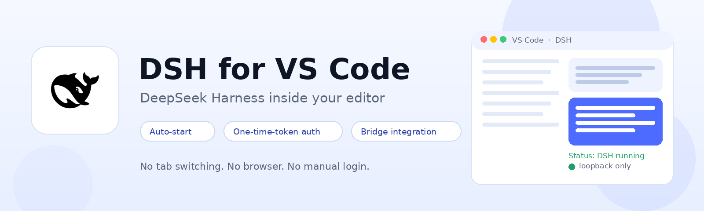
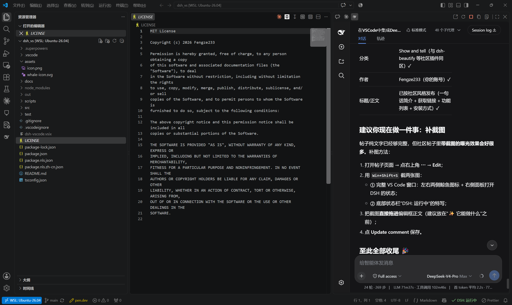
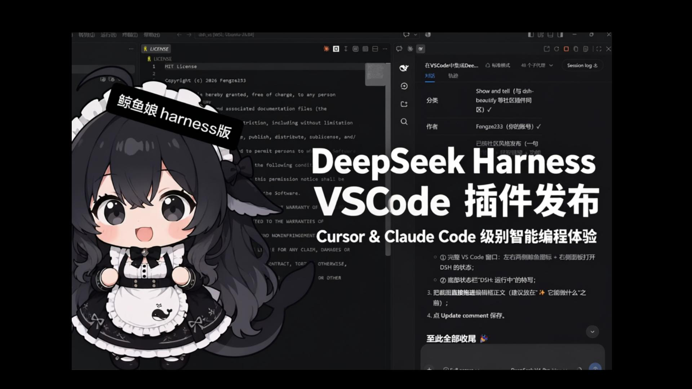
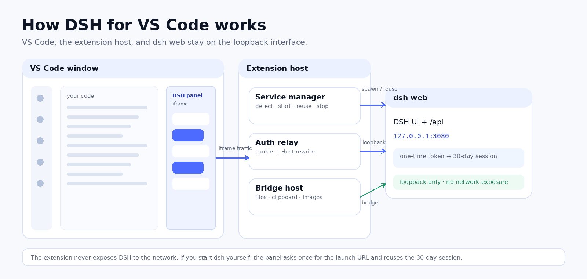

# DSH for VS Code 🐳

[](https://marketplace.visualstudio.com/items?itemName=Fengze233.dsh-vscode-panel)
[](https://marketplace.visualstudio.com/items?itemName=Fengze233.dsh-vscode-panel)
[](https://marketplace.visualstudio.com/items?itemName=Fengze233.dsh-vscode-panel)
[](https://github.com/Fengze233/dsh-vscode)
[](https://github.com/Fengze233/dsh-vscode/actions/workflows/ci.yml)
[](https://opensource.org/licenses/MIT)
[](https://code.visualstudio.com/)

**English** | [中文](README.zh.md)



**DeepSeek Harness (DSH) inside VS Code.** Click the whale and get the full DSH web UI beside your code — the extension starts or reuses `dsh web`, handles DSH's one-time-token authentication, and adds native file, clipboard and image integration.

> ⭐ **If DSH saves you context switches, star the repo.** It is the simplest way to help more VS Code users find it.

Works with **DSH 0.1.2 and newer**, including its browser authentication (auto sign-in, no manual step). Older DSH (≤ 0.1.1, no auth) keeps working. Both npm-installed `dsh` and DSH Desktop on Windows are supported.

## 🚀 Quick start

1. **Install the extension** from the [Marketplace](https://marketplace.visualstudio.com/items?itemName=Fengze233.dsh-vscode-panel), or run:

   ```bash
   code --install-extension Fengze233.dsh-vscode-panel
   ```

2. **Click the DSH whale** in the left Activity Bar or the right Secondary Side Bar.
3. **Done.** The extension starts (or reuses) `dsh web`, signs the panel in, and shows DSH next to your code. No terminal, no browser tab, no manual login for a service it started itself.

**Prerequisite:** install the `dsh` CLI from [DeepSeek Harness](https://github.com/deepseek-ai/deepseek-harness) and put it on your PATH — or install DSH Desktop on Windows. If `dsh` is missing, the extension shows a hint; `DSH: Show Logs` prints the detected path, source and version.

<details>
<summary><b>Other ways to install (VSIX / from source)</b></summary>

**VSIX package:** download the latest `dsh-vscode.vsix` from [Releases](https://github.com/Fengze233/dsh-vscode/releases), then in VS Code run `Extensions: Install from VSIX...` and reload the window.

**From source:**

```bash
git clone https://github.com/Fengze233/dsh-vscode.git
cd dsh-vscode
npm install
npm run package        # produces dsh-vscode.vsix
```

</details>

## 🎯 Why DSH in VS Code?

| | |
|---|---|
| **Stay in the editor** | DSH lives in the sidebar or a side panel. Review code, run commands and talk to the agent without switching to a terminal or browser. |
| **Zero-config lifecycle** | The extension detects the port, reuses an existing `dsh web`, or starts one silently and loads it once ready. Closing the window stops only the service it started. |
| **Native editor integration** | A small bridge makes file paths clickable in VS Code, opens external links in your browser, routes copy buttons through the extension host, and restores undo/redo in the embedded page. |
| **Auth that just works** | DSH ≥ 0.1.2 prints a one-time launch URL; the extension exchanges it for a 30-day session and serves the panel through a local loopback relay, so the cross-site iframe keeps working. |
| **Works where you work** | Local, WSL, SSH Remote, Dev Containers and Codespaces (remote scenarios are opt-in via `dsh.remote.enabled`). |
| **Private by design** | Loopback addresses only (`127.0.0.1` / `localhost` / `[::1]`); no credentials are read; the relay is not exposed to the network. |

## 📸 Screenshot



*DSH embedded in the right-side panel — code and agent side by side.*

## 🎬 Demo video

[](https://www.bilibili.com/video/BV1p8bD6dE18)

*59-second demo on Bilibili (Chinese): [BV1p8bD6dE18](https://www.bilibili.com/video/BV1p8bD6dE18)*

## 🆕 What's new in 0.4.4

- **Accurate stopping state** ([#40](https://github.com/Fengze233/dsh-vscode/pull/40)): when you click **Stop Service**, the panel now says “Stopping DSH service…” and the status bar turns orange — it no longer pretends to be “Starting”.
- **DSH Desktop on a non-default drive** ([#41](https://github.com/Fengze233/dsh-vscode/issues/41)): if Desktop is installed outside `%LOCALAPPDATA%` (for example `H:\DeepSeek Harness`), the extension now uses the Desktop command already on PATH as a fallback instead of failing with `ENOENT`.
- This is a maintenance release; no new panels or commands. Full history: [CHANGELOG](CHANGELOG.md).

## ✨ Features at a glance

| Feature | What you get |
|---|---|
| 🖱️ **One-click open** | A whale icon in the left Activity Bar and the right Secondary Side Bar; the editor title bar has a white-bg whale that opens the right-side panel. |
| 🚀 **Service management** | Auto-detect the port; reuse a running `dsh web`, otherwise start one in the background. Port conflicts temporarily fall back to the first free port, with a notification. |
| 🛟 **Recoverable errors** | Dedicated pages for missing `dsh`, occupied port, start timeout, crash and disconnect — each with a one-click reconnect. |
| 🔐 **Auth relay** | Parses the one-time launch URL, stores a 30-day session cookie, and forwards the panel through a loopback relay. Externally started services get a one-time paste page. |
| 🔗 **Bridge integration** | File paths open in VS Code, external links open in your browser, copy buttons work, and undo/redo is restored in the embedded page. |
| 🖼️ **Images without vision** | Attach images even when the active model has no vision: the image is cached in the workspace and sent as a file-path reference; the model reads it with an image tool. Opt out with `dsh.image.fallback`. |
| 🌐 **Remote-ready** | SSH Remote, Dev Containers and Codespaces run `dsh` on the remote and tunnel the panel; WSL works without a tunnel. |
| ⚙️ **Customizable** | Custom DSH profile, port, launch preference (npm / Desktop / auto), executable path, extra args, proxy env, timeout and panel zoom. |
| 🌍 **Bilingual** | UI copy follows the VS Code display language: Chinese for `zh-*`, English otherwise. |

## 🕹 Everyday use

- Click the whale in the Activity Bar or Secondary Side Bar; the panel title bar has **Open in Browser**, **Restart Service**, **Stop Service**, **Copy URL** and **Show Logs**.
- The status bar shows the live service state (running / starting / stopping / failed / stopped); click it to toggle the panel.
- If `dsh.port` is occupied by another program, the extension temporarily switches to the first free port for this session and tells you; your setting is unchanged.
- Platform rule: the left whale opens the left panel, the right whale opens the right panel; a sidebar view cannot be moved into the editor area.

### Command palette (`DSH:`)

| Command | Description |
|---|---|
| `DSH: Open Panel` | Open the left panel |
| `DSH: Open in Secondary Side Bar` | Open the right panel |
| `DSH: Open Right Panel` | Editor-title whale button: open the right panel |
| `DSH: Open in Browser` | Open the DSH page in the system browser |
| `DSH: Restart Service` | Restart the extension-managed service |
| `DSH: Stop Service` | Stop the extension-started service |
| `DSH: Copy URL` | Copy the DSH page URL |
| `DSH: Show Logs` | Open the extension log output channel |
| `DSH: Copy Logs` | Copy the full log (environment info + service log) for bug reports |
| `DSH: Retry Bridge Install` | Reinstall the bridge and restart the service |
| `DSH: Uninstall Bridge` | Remove the bridge package and restore `cordis.patch.yml` |
| `DSH: Clean Up Image Cache` | Delete cached `dsh-imgcache-*` files |

## ❓ FAQ / Troubleshooting

<details>
<summary><b>“dsh not found” / the panel won't start</b></summary>

Install the `dsh` CLI (`npm i -g @deepseek-ai/dsh`) or DSH Desktop, then make sure the command is on PATH. With `dsh.launchPreference: auto`, the extension prefers an npm install and falls back to Desktop. If Desktop lives in a custom directory, set `dsh.desktopCommandPath`; if you use a wrapper script, set `dsh.executablePath`. Since 0.4.4, a Desktop command already on PATH is used even when Desktop is installed on a non-default drive. Run `DSH: Copy Logs` and check the `dsh 可执行文件` / `dsh 启动来源` / `dsh 实际入口` lines.
</details>

<details>
<summary><b>npm version or DSH Desktop — which one is used?</b></summary>

`auto` prefers npm and falls back to Desktop; set `dsh.launchPreference` to `npm` or `desktop` to force one. Note that the official DSH Desktop uses the `desktop` profile, while VS Code uses `web` by default: sessions/settings are shared under `~/.dsh`, but plugins are installed per profile. To use DSH plugins in VS Code, install them into the `web` profile.
</details>

<details>
<summary><b>Blank panel, 401, or the login page</b></summary>

DSH ≥ 0.1.2 requires a browser session. For a service the extension started itself, sign-in is automatic. For a service you started outside VS Code, the extension cannot read its log: copy the launch URL from that service's log and paste it once into the panel — the session lasts up to 30 days. Check `DSH: Show Logs` for the detected URL/port and `401` handling.
</details>

<details>
<summary><b>The model API is unreachable behind a proxy</b></summary>

Set `dsh.useEnvProxy: true`, or use `dsh.env` to inject `NODE_OPTIONS=--use-env-proxy` and provide `HTTPS_PROXY` / `HTTP_PROXY`. The proxy variables must be visible to the `dsh web` child process.
</details>

<details>
<summary><b>Images are not sent</b></summary>

`dsh.image.fallback` must be on (default), and a workspace folder must be open so the image can be cached. Vision-capable models keep the native image upload. Temporary images are deleted after use; `DSH: Clean Up Image Cache` purges leftovers.
</details>

<details>
<summary><b>SSH Remote / WSL / Dev Containers</b></summary>

Remote support is opt-in: enable `dsh.remote.enabled` and install the extension on the remote host (VS Code prompts). The panel then opens through a VS Code tunnel; the service still listens on the remote loopback. WSL works without a tunnel.
</details>

<details>
<summary><b>How do I know the bridge was updated?</b></summary>

Open the DSH panel DevTools console: you should see `[dsh-vscode-bridge] handshake ok, v0.4.4, imageFallback=true`. The bridge version always matches the extension version; the installer force-reinstalls on a version **or** `client.js` content mismatch. If it still shows an older version, run `DSH: Retry Bridge Install` or restart the DSH service.
</details>

<details>
<summary><b>Port 3080 is already in use</b></summary>

If another program owns the port, the extension temporarily switches to the first free port for this session and tells you. Your `dsh.port` setting is unchanged. Set `dsh.port` to pick a different default.
</details>

## 🏗 How it works



The extension owns the service lifecycle and a local relay. The panel is an iframe inside a VS Code webview; the extension host talks to `dsh web` on `127.0.0.1`. The bridge runs inside the DSH page and relays editor actions through `postMessage`.

### 🔐 DSH ≥0.1.2 authentication & the local relay

DSH 0.1.2 introduced mandatory browser authentication. On startup `dsh web` prints a one-time launch URL:

```
dsh web: http://127.0.0.1:3080/?token=<one-time token>
```

Visiting it returns `303` plus a signed session cookie (`HttpOnly; SameSite=Strict`, bound to the request `Host`, 30-day lifetime). Every page and `/api` call then requires that cookie; without it DSH answers `401 dsh web authentication required`.

**Why a relay is needed.** The panel is a cross-site iframe (its top-level document is `vscode-webview://…`), and browsers never send a `SameSite=Strict` cookie in that context. So the iframe cannot log itself in, no matter what URL it loads.

**What the extension does** (automatic for a service it started):

1. Recognizes `401/403` with a `dsh web` body marker as “DSH is running and needs a login” instead of “port occupied”;
2. Parses the launch URL from the child process output (the token is masked in logs and never echoed in errors);
3. Exchanges it once for the session cookie and stores it in extension private storage, keyed by `host:port` (30 days; a service restart does not invalidate it);
4. Runs a **loopback relay** (random port on `127.0.0.1`): the iframe loads the relay, which forwards traffic to `dsh web`, injects the cookie, rewrites `Host`, and adapts DSH's `/api` browser-trust fence (the relay strips browser-origin headers as a trusted local intermediary). Uploads, SSE streams and WebSocket upgrades are forwarded as streams;
5. If the session expires, the relay reports `401` upstream and the extension re-acquires the session (self-started service) or shows the sign-in page again.

**If you start DSH yourself** (systemd, a terminal), the extension cannot read that process's log, so the panel shows a one-time **sign-in page**: paste the launch URL from the service log (for example `journalctl -u dsh -n 100`). One paste lasts up to 30 days, and a service restart does *not* require pasting again. A bare `http://127.0.0.1:3080/` also works for DSH ≤ 0.1.1 (no auth).

**Exposure of the relay**: it listens on `127.0.0.1` only and holds a 30-day session, so any local process (including other local users) that finds the port can drive that session — the same exposure as a DSH ≤ 0.1.1 service listening on `127.0.0.1:3080` without authentication, and narrower in practice (the port is random and must be scanned). DSH 0.1.2's authentication protects against network exposure and cross-site browser contexts; the relay does not reintroduce network exposure.

### 🔗 Bridge integration

The extension installs its own bridge package `dsh-vscode-bridge` into DSH's official client-plugin extension point under your DSH user directory. It enables:

- 🔗 **External links**: links in the panel open in your system browser instead of being trapped in the iframe;
- 📂 **File jumps**: clicking a file path opens the file in VS Code;
- 📋 **Clipboard copy**: copy buttons (such as code-block copy) are routed through the extension host, working around VS Code's clipboard block for cross-origin iframes;
- ↩️ **Undo/redo**: VS Code swallows standard shortcuts in nested iframes, and DSH's input is a controlled editor whose native undo stack is empty. After handshake the bridge keeps a per-element manual undo/redo stack (typing grouped per 400 ms), with native undo preferred when it works;
- 🖼️ **Image fallback**: images for non-vision models are cached and sent as file-path references (see `dsh.image.fallback`).

**Install / uninstall transparency.** The bridge is installed into `$DSH_HOME/profiles/<dsh.profile>` (default `~/.dsh/profiles/web`) and registered by a marked `insert:` block in `cordis.patch.yml` (`# dsh-vscode-bridge: begin/end`). The extension writes only to the user directory, never to the DSH installation. To remove it, uninstall the extension (VS Code runs the `uninstall` hook) or run `DSH: Uninstall Bridge`; both remove the marked entry and the bridge directory (best-effort, never blocking the uninstall).

> **Versioning:** the bridge package version is always identical to the extension version. The installer force-reinstalls whenever the bundled version differs **or** the bundled `client.js` content differs, so logic updates reach users even when the version number is unchanged.

**Bridge-related settings**

| Setting | Default | Description |
|---|---|---|
| `dsh.bridge.enabled` | `true` | Enable the bridge (when off: no install, no injection, no warning; the integrations are unavailable) |
| `dsh.workspaceRootIndex` | `0` | For multi-root workspaces: which root to use as the `dsh web` process working directory (out-of-range falls back to the first) |
| `dsh.bridge.silenceWarning` | `false` | Suppress the bridge degradation warning |

**Degradation behavior.** The bridge only works inside the panel. If it is inactive (for example, you open DSH in a browser, or installation failed), the panel remains fully usable — only the integrations above are unavailable. A one-time startup warning offers **Retry Install** / **Don't Show Again**.

## ⚙️ Settings (`dsh.*`)

| Setting | Default | Description |
|---|---|---|
| `dsh.profile` | `web` | DSH profile used for startup and bridge installation (custom profiles must provide the web UI) |
| `dsh.launchPreference` | `auto` | Which `dsh` install to prefer: `auto` (npm first, then DSH Desktop), `npm`, or `desktop`. If the preferred one is missing the other is used automatically; the log and environment header record the actual source |
| `dsh.desktopCommandPath` | (empty) | Absolute path of the DSH Desktop command (usually under `%LOCALAPPDATA%\Programs\DeepSeek Harness\...`); empty means auto-detect. Desktop installed on another drive is also found via PATH |
| `dsh.port` | `3080` | Desired port (used for both detection and startup) |
| `dsh.host` | `127.0.0.1` | Service address (loopback only) |
| `dsh.autoStart` | `true` | Auto-start the service when it is not running |
| `dsh.stopOnExit` | `true` | Stop the extension-started service when the last window closes |
| `dsh.extraArgs` | `[]` | Extra arguments appended when starting `dsh web` |
| `dsh.executablePath` | `""` | Absolute path to the `dsh` executable (`dsh.cmd` on Windows); empty = look up on PATH |
| `dsh.openInBrowser` | `false` | Open the DSH page in the default browser after the service starts (when off, `--no-open` is passed to `dsh web`) |
| `dsh.remote.enabled` | `false` | Enable remote scenarios (SSH Remote / WSL / Dev Containers / Codespaces): run dsh on the remote and open the panel through a VS Code tunnel (off by default; reload the window after enabling) |
| `dsh.image.fallback` | `true` | Send attached images as file-path references when the active model has no vision, instead of failing (files are cached under the workspace root and cleaned up after use) |
| `dsh.startTimeoutMs` | `45000` | How long to wait for `dsh web` to become ready, in milliseconds (5000–600000). Raise it on slow machines (Windows cold start measured at 17–23 s) |
| `dsh.env` | `{}` | Extra environment variables injected into the DSH child process (merged with the parent environment). Typical proxy use: `{"NODE_OPTIONS":"--use-env-proxy"}` |
| `dsh.useEnvProxy` | `false` | Append `--use-env-proxy` to the child process's `NODE_OPTIONS` (existing options are kept). Enable it when the model API is only reachable through an HTTP/HTTPS proxy |
| `dsh.panel.zoomLevel` | `1` | Zoom of the embedded page: pick `0.5`–`1.5` from the dropdown (0.05 steps); finer values via `settings.json` |

Set `"dsh.profile": "custom-profile"` and `"dsh.port": 3081` to launch `dsh --profile custom-profile --host 127.0.0.1 --port 3081 --no-open` and install the bridge into `$DSH_HOME/profiles/custom-profile`. Changing the profile restarts an extension-owned service; an existing external service is still reused by port. The default `web` profile preserves current behavior. Profile names may contain ASCII letters, numbers, dots, underscores and hyphens; they cannot start with a hyphen and cannot be `.` or `..`; surrounding whitespace is trimmed.

## 🌍 Localization

UI copy follows the VS Code display language (`Configure Display Language`): `zh-*` → Simplified Chinese, anything else → English. The package ships `package.nls.json`, `package.nls.zh-cn.json` and `package.nls.zh-hans.json`.

## 🧑‍💻 Development

Requirements: Node.js ≥ 22, VS Code ≥ 1.91.

```bash
npm install
npm run test          # 324 unit/integration tests (including real dsh web flows: service lifecycle, auth session)
npm run compile       # builds out/extension.js
npm run watch         # watch build
npm run typecheck     # type check
npm run package       # package .vsix
```

Debugging: open this folder in VS Code and press `F5` to launch the Extension Development Host.

```
src/
├── extension.ts          # entry: assembly and command registration
├── i18n.ts               # runtime copy dictionary (zh-* Chinese / otherwise English)
├── config.ts             # settings normalization (loopback whitelist)
├── service/
│   ├── detect.ts         # port probing (DSH marker detection)
│   ├── process.ts        # cross-platform subprocess wrapper (dsh / dsh.cmd)
│   ├── launcher.ts       # Windows launch resolution (npm / Desktop / explicit)
│   └── manager.ts        # service manager state machine (core)
├── bridge/               # bridge: installer, handshake host, message handling, status
├── panel/
│   ├── html.ts           # panel page templates (minimal CSP)
│   └── provider.ts       # WebviewViewProvider (iframe + placeholder pages)
├── workspaceRoot.ts      # multi-root workspace resolution
└── statusbar.ts          # status bar controller
```

## 🤝 Contributing

Issues and PRs are welcome. Keep PRs small and focused, and read [CONTRIBUTING.md](CONTRIBUTING.md) before opening one.

**PR checklist**

- [ ] One feature or fix per PR; open an issue first for large changes.
- [ ] **Do not bump versions** (`package.json`, `package-lock.json`, `bridge-client/package.json`, `BRIDGE_VERSION`) or add tags; releases are handled by maintainers.
- [ ] Do not add CHANGELOG version headings or release dates; put functional notes under `[Unreleased]`.
- [ ] Keep `README.md` and `README.zh.md` in sync; test counts must match `npm test`.
- [ ] Run `npm run typecheck`, `npm test`, `npm run compile` and `npx vsce package --no-dependencies`; CI must pass.
- [ ] Add tests for behavior changes; note the Windows test environment if the change is Windows-specific.
- [ ] Do not commit `out/`, `*.vsix`, logs or local caches.
- [ ] For UI changes attach a screenshot/recording; for new settings update both NLS files and both READMEs.

See [CONTRIBUTING.md](CONTRIBUTING.md) for the full rules.

## 🧭 Known limitations

- **Shift+drag from the VS Code Explorer (upstream)**: since VS Code 1.140, resource drags from the Explorer no longer deliver `dragenter`/`dragover`/`drop` to a webview ([microsoft/vscode#339278](https://github.com/microsoft/vscode/issues/339278); the upstream fix is still open). Use your system file manager or type `@` in the composer. Tracked in [issue #37](https://github.com/Fengze233/dsh-vscode/issues/37).
- **Image fallback needs a workspace folder**: files are cached under the workspace root; with no folder open, the fallback is unavailable. Temporary images are cleaned up after use; `DSH: Clean Up Image Cache` purges leftovers.
- **Externally started DSH (≥ 0.1.2)**: the extension cannot read another process's log, so the first sign-in needs one paste of the launch URL (then up to 30 days). A service restart does not require pasting again.

## 🌐 Community

This is a DeepSeek Harness community plugin (topic: [`dsh-plugin`](https://github.com/topics/dsh-plugin)).

- DSH official repo: <https://github.com/deepseek-ai/deepseek-harness>
- Issue tracker: <https://github.com/Fengze233/dsh-vscode/issues>
- DSH community discussions: <https://github.com/deepseek-ai/deepseek-harness/discussions>

## 🙏 Contributors & Acknowledgements

Many improvements here came from the community. Contributions are grouped by type (IDs link to the corresponding issue/PR in this repository):

### Code contributions

| Contributor | Contribution | Ref |
|---|---|---|
| [@jubeater](https://github.com/jubeater) | Configurable DSH profile and multi-profile bridge cleanup; accurate stopping-state UX | #35, #40 |

### Issue reports

| Reporter | Report | Ref |
|---|---|---|
| [@Donarli](https://github.com/Donarli) | DSH Desktop installed on a non-default drive (`H:\`) failing with ENOENT, with complete root-cause analysis and a suggested fix | #41 |
| [@Joshuayang228](https://github.com/Joshuayang228) | Shift+drag from the Explorer not reaching the webview: identified the VS Code regression and the Lexical second layer | #37 |
| [@AAAwoshi](https://github.com/AAAwoshi) | Panel reloading on every active-editor switch: traced it to the redundant `render()` and regenerated nonce, with log evidence and a minimal patch | #27 |
| [@Joshuayang228](https://github.com/Joshuayang228) | File clicks not forwarded to the editor: pinpointed the CSS Module hashed class name and provided reproduction evidence and a fix sketch | #22 |
| [@lizhuoyuan41-droid](https://github.com/lizhuoyuan41-droid) | Bridge package written into DSH Desktop's private command directory, breaking desktop startup: root cause plus an allow-list suggestion | #20 |
| [@Minelenbolan](https://github.com/Minelenbolan) | Duplicate bridge entry in `cordis.patch.yml` crashing the plugin tree | #19 |
| [@HafenYin](https://github.com/HafenYin) | Windows cold start exceeding the hard-coded 15 s timeout (with full startup log) | #23 |
| [@NOIPJohnny](https://github.com/NOIPJohnny) | DSH unable to reach the model API behind a proxy; suggested injecting child-process environment variables | #18 |
| [@ThinBuffalo](https://github.com/ThinBuffalo) | Request for zoom control of the embedded page | #8 |
| [@smallshieh](https://github.com/smallshieh) | Request for editor context injection (send the active file/selection with a message) | #10 |
| [@Tsechiyuan](https://github.com/Tsechiyuan) | Request to send the current selection straight into the conversation | #7 |
| [@sseryling](https://github.com/sseryling) | WSL Remote blank panel and bridge handshake failure: provided measured fixes | #13 |
| [@Zanford](https://github.com/Zanford) | DSH failing to start from VS Code | #12 |

### Upstream

- The narrow-viewport CJK caret issue (#9) was traced to the DSH frontend composer; upstream rewrote it as a Lexical editor and the issue was closed with that conclusion.
- Shift+drag from the Explorer is a VS Code regression ([#339278](https://github.com/microsoft/vscode/issues/339278) / [#339036](https://github.com/microsoft/vscode/issues/339036)); the upstream fix is tracked in [microsoft/vscode#344153](https://github.com/microsoft/vscode/pull/344153).

## 📄 License

[MIT](./LICENSE) © 2026 Fengze233

---

**If DSH makes your editor feel more complete, a ⭐ on GitHub helps other VS Code + DSH users find it.** It is the simplest way to support the project.
