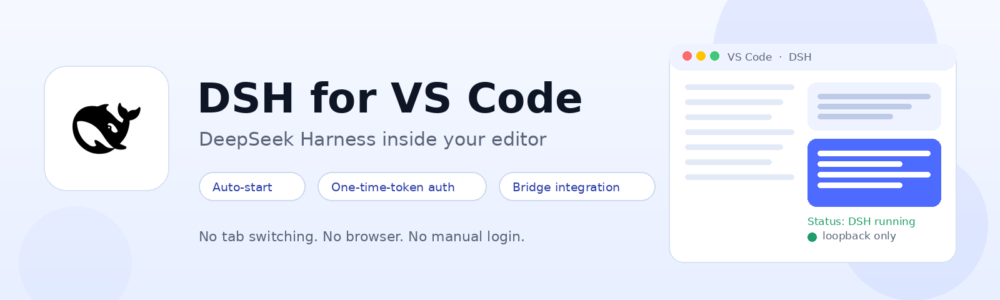
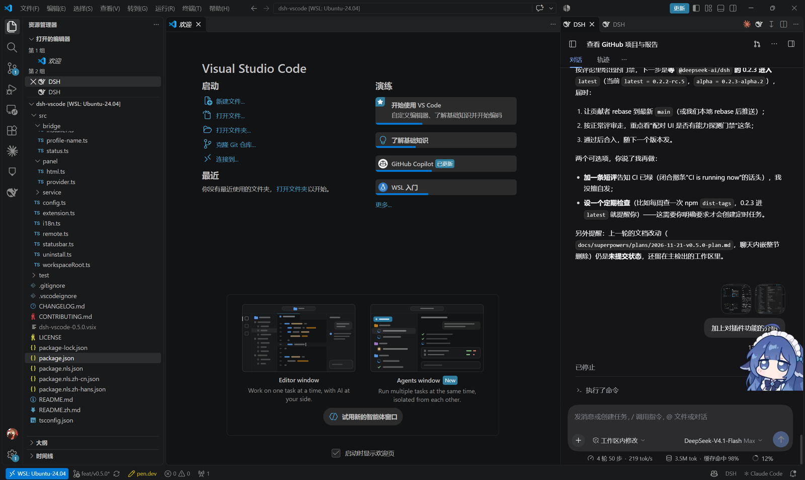
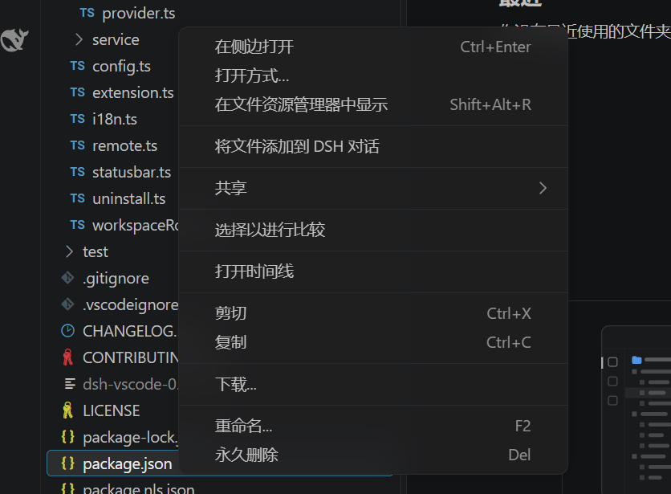
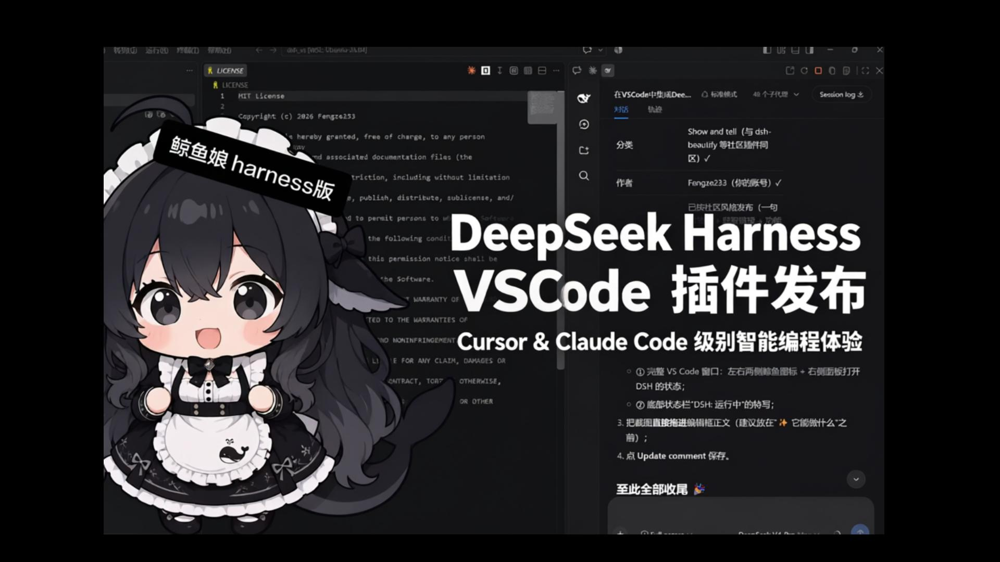
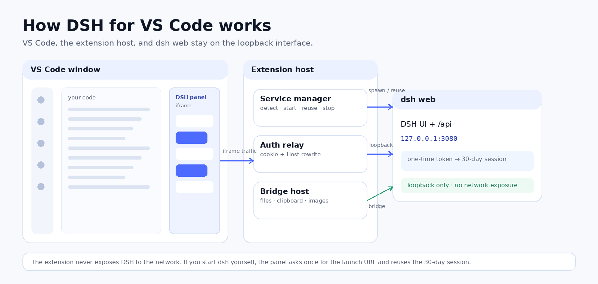

# DSH for VS Code 🐳

[](https://marketplace.visualstudio.com/items?itemName=Fengze233.dsh-vscode-panel)
[](https://github.com/Fengze233/dsh-vscode/releases)
[](https://github.com/Fengze233/dsh-vscode/actions/workflows/ci.yml)
[](https://opensource.org/licenses/MIT)
[](https://code.visualstudio.com/)

**English** | [中文](README.zh.md)



**The full DeepSeek Harness agent, docked beside your code.**

One click opens the full DSH UI as an editor tab or side panel. The extension starts or reuses `dsh web`, signs you in, and connects the page to the editor: clickable file paths, working copy buttons, images, and **right-click → Add to DSH Chat**.

[**Install from Marketplace**](https://marketplace.visualstudio.com/items?itemName=Fengze233.dsh-vscode-panel) · [Download VSIX](https://github.com/Fengze233/dsh-vscode/releases) · [Quick start](#-quick-start-3-minutes) · [Troubleshooting](#-troubleshooting)

```bash
code --install-extension Fengze233.dsh-vscode-panel
```



*Two independent DSH tabs beside your code — each tab keeps its own conversation, and reloading the window brings them back.*

> **Before you start:** VS Code ≥ 1.91 and a working `dsh` command (npm CLI or DSH Desktop). Works with DSH 0.1.2+; older no-auth versions keep working. [Install DeepSeek Harness →](https://github.com/deepseek-ai/deepseek-harness)

## ⚡ Quick start (3 minutes)

### 1. Install DSH once

DSH is the agent; this extension is the VS Code shell around it.

- **DSH Desktop (Windows):** install the desktop app (see the [DeepSeek Harness repository](https://github.com/deepseek-ai/deepseek-harness)).
- **npm:** `npm i -g @deepseek-ai/dsh`

Verify it works:

```bash
dsh --version
```

If you have not configured a model yet, do it once inside DSH — the panel opens DSH's own onboarding.

### 2. Install the extension

Install from the [Marketplace](https://marketplace.visualstudio.com/items?itemName=Fengze233.dsh-vscode-panel), or run the command above. Then reload the VS Code window.

<details>
<summary><b>Install from a VSIX or from source</b></summary>

**VSIX:** download `dsh-vscode.vsix` from [Releases](https://github.com/Fengze233/dsh-vscode/releases), then run **Extensions: Install from VSIX…** and reload.

**From source:**

```bash
git clone https://github.com/Fengze233/dsh-vscode.git
cd dsh-vscode
npm install
npm run package        # produces dsh-vscode.vsix
```

</details>

### 3. Open DSH

Three entry points, same agent:

| Where | What it opens |
|---|---|
| Whale in the **Activity Bar** | DSH in the left side panel |
| Whale in the **Secondary Side Bar** | DSH in the right side panel |
| Whale in the **editor title bar**, or `DSH` in the **status bar** | A **new DSH editor tab** |

Click the title-bar/status-bar entry again for another tab. Each tab is an independent DSH conversation; reloading the window restores all of them.

### 4. Add code to your first request

1. Right-click a file or folder in the Explorer → **Add File to DSH Chat** (folders say **Add Folder to DSH Chat**).
2. The path lands in the composer as `@path` (folders as `@folder/`). Type your question and press <kbd>Enter</kbd>.
3. Click any file path in DSH's answer to open it in the editor.

You can also type `@` in the composer to search files and folders, and select multiple files in the Explorer before right-clicking.

### 5. Day-to-day controls

- **Stop / restart:** buttons in the panel title bar, or `DSH: Restart Service` / `DSH: Stop Service`.
- **Open in browser:** `DSH: Open in Browser` (useful for voice input — see [Known limitations](#-known-limitations)).
- **Logs:** `DSH: Show Logs` / `DSH: Copy Logs`.
- **Zoom:** `dsh.panel.zoomLevel` scales the embedded page from 50% to 150%.

> **First run:** for a service the extension starts itself, sign-in is automatic. If you started `dsh web` outside VS Code, the panel shows a one-time sign-in page — paste the launch URL from that service's log (for example `journalctl -u dsh -n 100`). One paste lasts up to 30 days.

## ✨ What you get

Everything the extension adds on top of the DSH web UI:

| Feature | Why it matters |
|---|---|
| 🗂️ **Real editor tabs, many at once** | Every click opens a new tab with its own conversation. Switch tabs without losing the session; reload and they come back. |
| 🔐 **No login dance** | The extension captures DSH's one-time launch URL, exchanges it for a 30-day session and serves the panel through a loopback relay. Self-started services need zero manual login. |
| 📎 **Code context in one right-click** | Files and folders go into the composer as DSH-native `@` references — folders get the trailing slash DSH needs, and paths with spaces are quoted correctly. |
| 🔗 **Native editor bridge** | File paths open in VS Code, external links open in your browser, copy buttons are routed through the extension host, and undo/redo works inside the embedded composer. |
| 🖼️ **Images without a vision model** | Images are cached in the workspace and sent as file-path references, so an image can still reach the agent. Opt out with `dsh.image.fallback`. |
| 🌐 **Local, WSL and remote** | WSL works out of the box; SSH Remote, Dev Containers and Codespaces tunnel the panel when `dsh.remote.enabled` is on. |
| ⚙️ **Plays well with your setup** | Custom profile, port, launch preference (npm / Desktop), executable path, extra args, proxy env, startup timeout and page zoom. |
| 🛟 **Honest failure pages** | Missing `dsh`, occupied port, timeout, crash and disconnect each get a dedicated page with one-click recovery. |



*Right-click any file or folder → the path is inserted into the composer as a DSH `@` reference.*

## 🆚 Browser tab vs. DSH in VS Code

| Task | DSH in a browser tab | DSH in VS Code |
|---|---|---|
| Give the agent a file | Copy the path and type `@path` | Right-click → **Add File / Folder to DSH Chat** |
| Open a file the agent mentions | Find it in the Explorer yourself | Click the path → opens in the editor |
| Keep code and chat in view | Arrange two windows | Editor tab or side panel beside your code |
| Several conversations | Several browser tabs | Several VS Code tabs, restored after reload |
| Sign-in for a locally started DSH | Open the launch URL | Automatic |
| Remote development | Set up port forwarding | `dsh.remote.enabled` uses VS Code's tunnel |

## 🎬 See it in action

[](https://www.bilibili.com/video/BV1p8bD6dE18)

*59-second demo (Chinese): [BV1p8bD6dE18](https://www.bilibili.com/video/BV1p8bD6dE18)*

## 🆕 What's new in 0.5.1

- **Multiple tabs, properly** — every click on the editor-title whale or the status-bar `DSH` opens a new tab; tabs get their own DSH icon.
- **Status bar from startup** — the `DSH` item appears as soon as the window opens, even before the extension has been used.
- **Folder-aware context menu** — folders show **Add Folder to DSH Chat** instead of “Add File …”.
- **References DSH can actually parse** — folders are inserted as `@folder/` and paths with spaces as `@"my dir/file.ts"`, so mentions open and apply correctly.
- **Status bar opens the editor** — no more jumping to the side bar; it opens a new editor tab.

## 🕹 Commands

<details>
<summary><b>All commands</b></summary>

| Command | Description |
|---|---|
| `DSH: Open Panel` | Focus the left panel |
| `DSH: Open in Secondary Side Bar` | Focus the right panel |
| `DSH: Open in Editor` | Open a new DSH editor tab (also the title-bar/status-bar click) |
| `Add File to DSH Chat` | Explorer context menu: insert selected files as `@path` |
| `Add Folder to DSH Chat` | Explorer context menu: insert selected folders as `@folder/` |
| `DSH: Open in Browser` | Open the DSH page in your system browser |
| `DSH: Restart Service` | Restart the extension-managed service |
| `DSH: Stop Service` | Stop the extension-started service |
| `DSH: Copy URL` | Copy the DSH page URL |
| `DSH: Show Logs` | Open the DSH output channel |
| `DSH: Copy Logs` | Copy the full log (environment + service) for bug reports |
| `DSH: Retry Bridge Install` | Reinstall the bridge and restart the service |
| `DSH: Uninstall Bridge` | Remove the bridge package and restore `cordis.patch.yml` |
| `DSH: Clean Up Image Cache` | Delete cached `dsh-imgcache-*` files |

</details>

## ❓ Troubleshooting

<details>
<summary><b>“dsh not found” / the panel won't start</b></summary>

Install the CLI (`npm i -g @deepseek-ai/dsh`) or DSH Desktop, then make sure the command is on PATH. `dsh.launchPreference: auto` prefers npm and falls back to Desktop; for a custom Desktop location set `dsh.desktopCommandPath`, for a wrapper script set `dsh.executablePath`. Run `DSH: Copy Logs` and check the `dsh 可执行文件` / `dsh 启动来源` / `dsh 实际入口` lines.
</details>

<details>
<summary><b>Blank panel, 401, or the sign-in page</b></summary>

DSH ≥ 0.1.2 requires a browser session. For an extension-started service, sign-in is automatic. For a service you started outside VS Code, copy the launch URL from its log and paste it once into the panel — it lasts up to 30 days and survives service restarts. Check `DSH: Show Logs` for the detected URL, port and 401 handling.
</details>

<details>
<summary><b>npm CLI or DSH Desktop — which one is used?</b></summary>

`auto` prefers npm and falls back to Desktop. Force one with `dsh.launchPreference: npm` or `desktop`. DSH Desktop uses the `desktop` profile, while VS Code uses `web` by default: sessions and settings live under `~/.dsh`, but plugins are installed per profile — install DSH plugins in the `web` profile to use them here.
</details>

<details>
<summary><b>The model API is unreachable behind a proxy</b></summary>

Set `dsh.useEnvProxy: true`, or use `dsh.env` to inject `NODE_OPTIONS=--use-env-proxy` together with `HTTPS_PROXY` / `HTTP_PROXY`. The variables must reach the `dsh web` child process.
</details>

<details>
<summary><b>Images are not sent</b></summary>

`dsh.image.fallback` must be on (default) and a workspace folder must be open so the image can be cached. Vision-capable models keep the native image upload. `DSH: Clean Up Image Cache` removes leftovers.
</details>

<details>
<summary><b>SSH Remote / WSL / Dev Containers</b></summary>

Enable `dsh.remote.enabled` and install the extension on the remote host (VS Code prompts). The panel opens through a VS Code tunnel while `dsh` keeps listening on the remote loopback. WSL works without a tunnel.
</details>

<details>
<summary><b>How do I check the bridge version?</b></summary>

Open DevTools inside the DSH panel; the console shows `[dsh-vscode-bridge] handshake ok, v…`. The bridge version always matches the extension version, and it reinstalls on a version **or** `client.js` content mismatch. If it is stale, run `DSH: Retry Bridge Install` or restart the DSH service.
</details>

## ⚙️ Settings

<details>
<summary><b>All <code>dsh.*</code> settings</b></summary>

| Setting | Default | Description |
|---|---|---|
| `dsh.profile` | `web` | DSH profile for startup and bridge installation (custom profiles must provide the web UI) |
| `dsh.launchPreference` | `auto` | Which `dsh` install to prefer: `auto` (npm, then Desktop), `npm`, or `desktop` |
| `dsh.desktopCommandPath` | empty | Absolute path to the Desktop command; empty auto-detects (PATH is also checked) |
| `dsh.host` | `127.0.0.1` | Service address (loopback only) |
| `dsh.port` | `3080` | Desired port for probing and startup |
| `dsh.autoStart` | `true` | Start the service when it is not running |
| `dsh.stopOnExit` | `true` | Stop the extension-started service when the last window closes |
| `dsh.extraArgs` | `[]` | Extra arguments appended to `dsh web` |
| `dsh.executablePath` | empty | Absolute path to the `dsh` executable (`dsh.cmd` on Windows) |
| `dsh.openInBrowser` | `false` | Open the DSH page in the default browser after startup |
| `dsh.remote.enabled` | `false` | Enable remote scenarios (tunnel the panel via VS Code); reload after changing |
| `dsh.image.fallback` | `true` | Send images as file-path references when the model has no vision |
| `dsh.startTimeoutMs` | `45000` | How long to wait for `dsh web` to become ready (Windows cold start is 17–23 s) |
| `dsh.env` | `{}` | Extra environment variables for the DSH child process |
| `dsh.useEnvProxy` | `false` | Append `--use-env-proxy` to the child's `NODE_OPTIONS` |
| `dsh.panel.zoomLevel` | `1` | Embedded page zoom, 0.5–1.5 |
| `dsh.workspaceRootIndex` | `0` | Multi-root workspaces: which root becomes the `dsh web` working directory |
| `dsh.workspace.autoOpen` | `true` | Newly opened DSH editor tabs switch DSH to the current VS Code workspace folder and open/reuse a blank session there; restored tabs are untouched |
| `dsh.bridge.enabled` | `true` | Enable the editor bridge (file links, clipboard, undo/redo, images) |
| `dsh.bridge.silenceWarning` | `false` | Suppress the bridge degradation warning |

</details>

## 🏗 How it works



The extension owns the service lifecycle and a local relay. The panel is an iframe inside a VS Code webview; the extension host talks to `dsh web` on `127.0.0.1`. A small bridge inside the DSH page relays editor actions over `postMessage`.

<details>
<summary><b>Authentication and the loopback relay</b></summary>

DSH 0.1.2 introduced mandatory browser authentication. On startup `dsh web` prints a one-time launch URL:

```
dsh web: http://127.0.0.1:3080/?token=<one-time token>
```

Visiting it returns a 30-day `HttpOnly; SameSite=Strict` session cookie bound to the request `Host`. The panel is a cross-site iframe (`vscode-webview://…`), so that cookie is never sent by the browser and the iframe cannot log itself in.

For a service the extension starts, it parses the launch URL from the child output, exchanges it once for the cookie, stores it in extension-private storage keyed by `host:port`, and runs a **loopback relay**: the iframe loads the relay, which forwards traffic to `dsh web`, injects the cookie, rewrites `Host`, strips browser-origin headers as a trusted local intermediary, and streams uploads, SSE and WebSocket upgrades. When the session expires, the relay reports upstream `401` and the extension re-acquires it (or shows the sign-in page again).

The relay listens on `127.0.0.1` only and is not exposed to the network. It holds a 30-day session, so a local process that finds the random relay port could drive that session — the same local exposure as a DSH ≤ 0.1.1 service on `127.0.0.1:3080`, but not a network exposure.

</details>

<details>
<summary><b>The editor bridge</b></summary>

The extension installs `dsh-vscode-bridge` into DSH's official client-plugin extension point under `$DSH_HOME/profiles/<profile>` and registers it with a marked `insert:` block in `cordis.patch.yml`. It adds:

- external links open in the system browser instead of being trapped in the iframe;
- file paths open in VS Code;
- copy buttons are routed through the extension host (VS Code blocks clipboard access for cross-origin iframes);
- undo/redo is restored inside the embedded composer (VS Code swallows the shortcuts and the editor's native stack is empty);
- images work even when the active model has no vision.

The bridge only works inside the panel. If it is inactive (browser use, failed install), the panel stays fully usable — only those integrations are missing. A one-time warning offers **Retry Install** / **Don't Show Again**. Uninstall the extension or run `DSH: Uninstall Bridge` to remove the package and its marked `cordis.patch.yml` entry.

</details>

## 🌍 Localization

UI copy follows the VS Code display language: `zh-*` shows Simplified Chinese, everything else English. The package ships `package.nls.json`, `package.nls.zh-cn.json` and `package.nls.zh-hans.json`.

## 🧑‍💻 Development

Requirements: Node.js ≥ 22, VS Code ≥ 1.91.

```bash
npm install
npm run test          # 357 unit/integration tests (including real dsh web flows: service lifecycle, auth session)
npm run compile       # builds out/extension.js
npm run watch         # watch build
npm run typecheck     # type check
npm run package       # package .vsix
```

Open the folder in VS Code and press <kbd>F5</kbd> for the Extension Development Host. The main modules live under `src/`: `service/` (detection, process, launcher, state machine), `bridge/` (installer, handshake, message handling), `panel/` (HTML templates and the webview provider), plus `config.ts`, `workspaceRoot.ts` and `statusbar.ts`.

## 🤝 Contributing

Issues and PRs are welcome. Keep PRs small and focused, and read [CONTRIBUTING.md](CONTRIBUTING.md) before opening one. Run `npm run typecheck`, `npm test`, `npm run compile` and `npx vsce package --no-dependencies`; CI must pass. Do not bump versions, add CHANGELOG version headings, or commit `out/`, `*.vsix` or local caches. Keep `README.md` and `README.zh.md` in sync — the test count must match `npm test`.

## 🧭 Known limitations

- **Shift+drag from the Explorer (upstream VS Code):** since 1.140, Explorer drags no longer deliver `dragenter`/`dragover`/`drop` to a webview ([microsoft/vscode#339278](https://github.com/microsoft/vscode/issues/339278)). Use the system file manager or type `@` in the composer. Tracked in [issue #37](https://github.com/Fengze233/dsh-vscode/issues/37).
- **No microphone inside the panel:** VS Code's webview iframe does not delegate `microphone`, so DSH's voice input cannot work there. Use `DSH: Open in Browser` for voice.
- **Image fallback needs a workspace folder:** images are cached under the workspace root; with no folder open the fallback is unavailable.
- **Externally started DSH (≥ 0.1.2):** the extension cannot read another process's log, so the first sign-in needs one paste of the launch URL (then up to 30 days).

## 🌐 Community

This is a DeepSeek Harness community plugin (topic: [`dsh-plugin`](https://github.com/topics/dsh-plugin)).

- DSH official repo: <https://github.com/deepseek-ai/deepseek-harness>
- Issue tracker: <https://github.com/Fengze233/dsh-vscode/issues>
- DSH community discussions: <https://github.com/deepseek-ai/deepseek-harness/discussions>

## 🙏 Contributors & acknowledgements

<details>
<summary><b>Community contributions</b></summary>

Many improvements here came from the community (IDs link to the corresponding issue/PR):

**Code contributions**

| Contributor | Contribution | Ref |
|---|---|---|
| [@jubeater](https://github.com/jubeater) | Configurable DSH profile and multi-profile bridge cleanup; accurate stopping-state UX | #35, #40 |
| [@log-li](https://github.com/log-li) | Root-cause analysis and patch for image links that could not be opened (existence-first, filename fallback) | #45 |

**Issue reports**

| Reporter | Report | Ref |
|---|---|---|
| [@Donarli](https://github.com/Donarli) | DSH Desktop installed on a non-default drive (`H:\`) failing with ENOENT, with complete root-cause analysis and a suggested fix | #41 |
| [@log-li](https://github.com/log-li) | Image links in chat never opening: traced it to DSH omitting `title` on image links plus the bridge falling back to button text, with production evidence | #43 |
| [@Joshuayang228](https://github.com/Joshuayang228) | Shift+drag from the Explorer not reaching the webview: identified the VS Code regression and the Lexical second layer | #37 |
| [@AAAwoshi](https://github.com/AAAwoshi) | Panel reloading on every active-editor switch: traced it to the redundant `render()` and regenerated nonce, with log evidence and a minimal patch | #27 |
| [@Joshuayang228](https://github.com/Joshuayang228) | File clicks not forwarded to the editor: pinpointed the CSS Module hashed class name and provided reproduction evidence and a fix sketch | #22 |
| [@lizhuoyuan41-droid](https://github.com/lizhuoyuan41-droid) | Bridge package written into DSH Desktop's private command directory, breaking desktop startup: root cause plus an allow-list suggestion | #20 |
| [@Minelenbolan](https://github.com/Minelenbolan) | Duplicate bridge entry in `cordis.patch.yml` crashing the plugin tree | #19 |
| [@HafenYin](https://github.com/HafenYin) | Windows cold start exceeding the hard-coded 15 s timeout (with full startup log) | #23 |
| [@NOIPJohnny](https://github.com/NOIPJohnny) | DSH unable to reach the model API behind a proxy; suggested injecting child-process environment variables | #18 |
| [@ThinBuffalo](https://github.com/ThinBuffalo) | Request for zoom control of the embedded page | #8 |
| [@smallshieh](https://github.com/smallshieh) | Request for editor context injection (send the active file/selection with a message) | #10 |
| [@Tsechiyuan](https://github.com/Tsechiyuan) | Request to send the current selection straight into the conversation | #7 |
| [@sseryling](https://github.com/sseryling) | WSL Remote blank panel and bridge handshake failure: provided measured fixes | #13 |
| [@Zanford](https://github.com/Zanford) | DSH failing to start from VS Code | #12 |

</details>

<details>
<summary><b>Upstream notes</b></summary>

- The narrow-viewport CJK caret issue (#9) was traced to the DSH frontend composer; upstream rewrote it as a Lexical editor.
- Shift+drag from the Explorer is a VS Code regression ([#339278](https://github.com/microsoft/vscode/issues/339278) / [#339036](https://github.com/microsoft/vscode/issues/339036)); the upstream fix is tracked in [microsoft/vscode#344153](https://github.com/microsoft/vscode/pull/344153).

</details>

## 📄 License

[MIT](./LICENSE) © 2026 Fengze233

---

**Try it now:** install from the [Marketplace](https://marketplace.visualstudio.com/items?itemName=Fengze233.dsh-vscode-panel), or grab the [VSIX](https://github.com/Fengze233/dsh-vscode/releases). If DSH becomes part of your daily loop, a Marketplace rating is what helps other developers find this extension; a GitHub star helps contributors find the repo.
