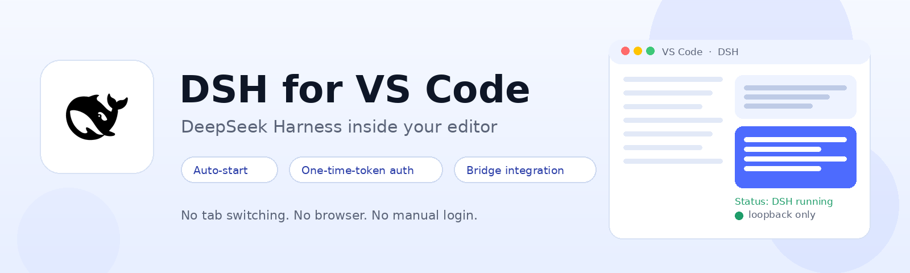
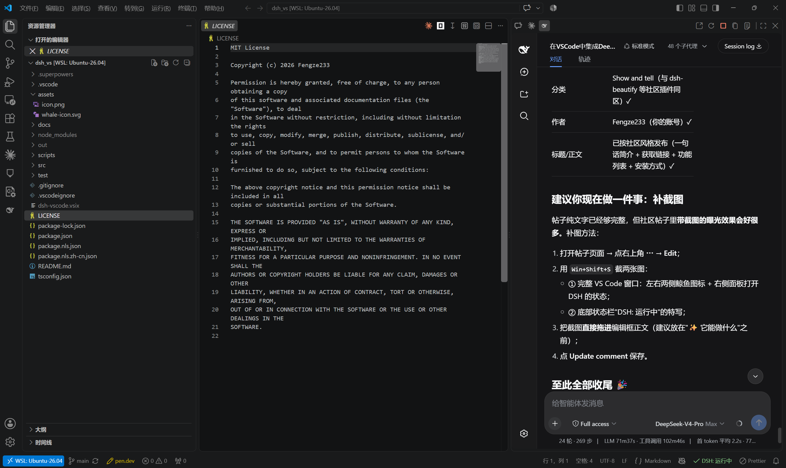
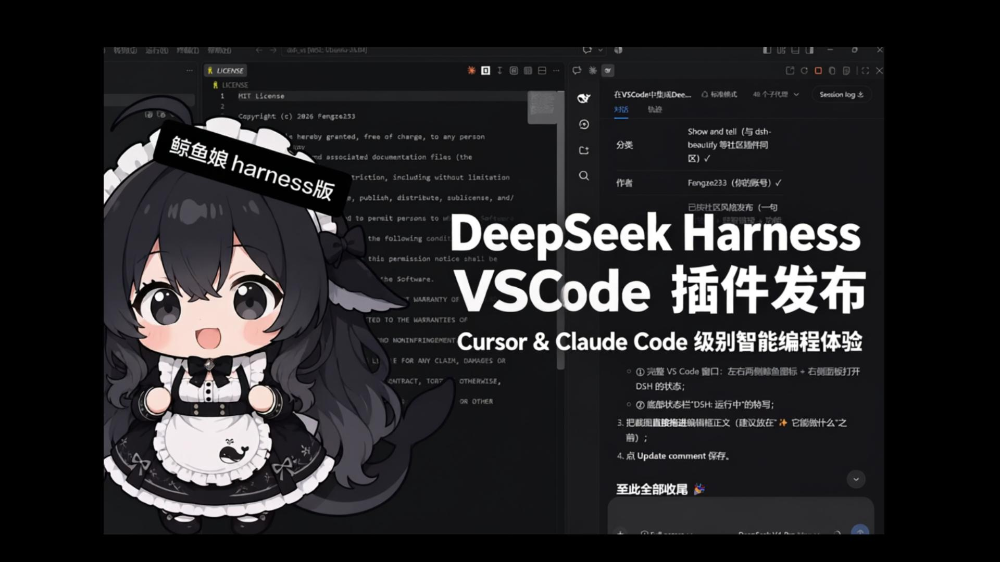
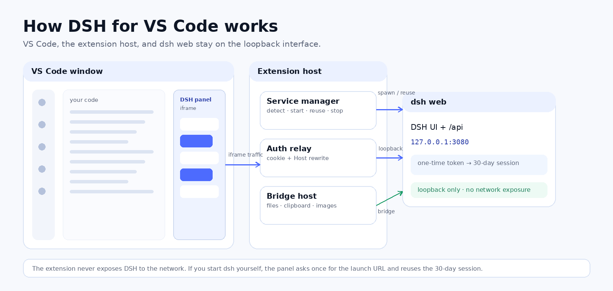

# DSH for VS Code 🐳

[](https://marketplace.visualstudio.com/items?itemName=Fengze233.dsh-vscode-panel)
[](https://marketplace.visualstudio.com/items?itemName=Fengze233.dsh-vscode-panel)
[](https://marketplace.visualstudio.com/items?itemName=Fengze233.dsh-vscode-panel)
[](https://github.com/Fengze233/dsh-vscode)
[](https://github.com/Fengze233/dsh-vscode/actions/workflows/ci.yml)
[](https://opensource.org/licenses/MIT)
[](https://code.visualstudio.com/)

[English](README.md) | **中文**



**在 VS Code 里直接使用 DeepSeek Harness（DSH）。** 点击鲸鱼图标，DSH 网页就出现在代码旁边——插件负责启动或复用 `dsh web`、处理 DSH 的一次性 token 鉴权，并通过桥接把文件、剪贴板和图片能力接到编辑器里。

> ⭐ **如果 DSH 帮你减少了上下文切换，欢迎给仓库点个 Star。** 这是让更多 VS Code + DSH 用户发现它最简单的方式。

支持 **DSH 0.1.2 及更新版本**（含浏览器鉴权，自启服务自动登录）；更早的 DSH（≤ 0.1.1，无鉴权）保持可用。Windows 上同时支持 npm 安装的 `dsh` 与 DSH Desktop。

## 🚀 快速开始

1. **安装扩展**：在 [Marketplace](https://marketplace.visualstudio.com/items?itemName=Fengze233.dsh-vscode-panel) 搜索安装，或运行：

   ```bash
   code --install-extension Fengze233.dsh-vscode-panel
   ```

2. **点击左侧活动栏或右侧辅助侧边栏里的 DSH 鲸鱼图标**。
3. **完成。** 插件会自动启动（或复用）`dsh web`、完成登录，并把 DSH 显示在代码旁边。对插件自己启动的服务，不需要终端、不需要浏览器标签页、也不需要手工登录。

**前置条件**：安装 [DeepSeek Harness](https://github.com/deepseek-ai/deepseek-harness) 的 `dsh` CLI 并加入 PATH，或者在 Windows 上安装 DSH Desktop。找不到 `dsh` 时插件会给出提示；`DSH: 查看日志` 会打印实际路径、来源和版本。

<details>
<summary><b>其他安装方式（VSIX / 源码构建）</b></summary>

**VSIX 安装包**：从 [Releases](https://github.com/Fengze233/dsh-vscode/releases) 下载最新的 `dsh-vscode.vsix`，在 VS Code 里运行 `Extensions: Install from VSIX...`，然后重载窗口。

**从源码构建：**

```bash
git clone https://github.com/Fengze233/dsh-vscode.git
cd dsh-vscode
npm install
npm run package        # 产出 dsh-vscode.vsix
```

</details>

## 🎯 为什么在 VS Code 里用 DSH？

| | |
|---|---|
| **不离开编辑器** | DSH 就在侧边栏或侧面板里。看代码、跑命令、和 Agent 对话，不用在终端、浏览器和 IDE 之间来回切。 |
| **零配置的服务生命周期** | 自动探测端口：已有 `dsh web` 就复用，没有就在后台静默启动，就绪后加载。关闭窗口只停止插件自己启动的服务。 |
| **原生编辑器联动** | 桥接让面板里的文件路径可在 VS Code 打开、外链走系统浏览器、复制按钮走扩展宿主，并恢复内嵌页面的撤销/重做。 |
| **鉴权自动完成** | DSH ≥ 0.1.2 会打印一次性启动网址；插件兑换 30 天会话，并通过本地回环代理转发面板流量，跨站 iframe 也能正常工作。 |
| **本地与远程都能用** | 本地、WSL、SSH Remote、Dev Containers、Codespaces（远程场景需通过 `dsh.remote.enabled` 显式开启）。 |
| **默认不暴露网络** | 只连接回环地址（`127.0.0.1` / `localhost` / `[::1]`），不读取凭据，代理不监听外部网络。 |

## 📸 界面截图



*DSH 嵌入右侧面板——代码与 Agent 并排。*

## 🎬 演示视频

[](https://www.bilibili.com/video/BV1p8bD6dE18)

*Bilibili 59 秒演示（中文）：[BV1p8bD6dE18](https://www.bilibili.com/video/BV1p8bD6dE18)*

## 🆕 0.4.4 新特性

- **停止状态更准确**（[#40](https://github.com/Fengze233/dsh-vscode/pull/40)）：点击「停止服务」后，面板显示「正在停止 DSH 服务…」，状态栏变为橙色，不再误显示「正在启动」。
- **DSH Desktop 装在非默认盘符**（[#41](https://github.com/Fengze233/dsh-vscode/issues/41)）：Desktop 不在 `%LOCALAPPDATA%`（例如 `H:\DeepSeek Harness`）时，插件会把 PATH 里已有的 Desktop 命令作为兜底，不再直接 `ENOENT`。
- 这是维护版本，没有新增面板或命令。完整历史见 [CHANGELOG](CHANGELOG.md)。

## ✨ 功能一览

| 功能 | 说明 |
|---|---|
| 🖱️ **一键打开** | 左侧活动栏与右侧辅助侧边栏各有一个鲸鱼图标；编辑器标题栏的白底鲸鱼打开右侧面板。 |
| 🚀 **服务管理** | 自动探测端口；复用正在运行的 `dsh web`，否则后台启动。端口被占用时临时切换到第一个空闲端口并提示。 |
| 🛟 **可恢复的错误页** | `dsh` 缺失、端口占用、启动超时、崩溃、断连都有独立页面，并提供一键重连。 |
| 🔐 **鉴权代理** | 解析一次性启动网址、保存 30 天会话 cookie，并通过回环代理转发面板；外部启动的服务提供一次性粘贴登录页。 |
| 🔗 **桥接联动** | 文件路径在 VS Code 打开、外链走系统浏览器、复制按钮可用、内嵌页面恢复撤销/重做。 |
| 🖼️ **无视觉模型也能发图** | 图片缓存到工作区，以文件路径引用随消息发出，模型可调用图像工具读取；可用 `dsh.image.fallback` 关闭。 |
| 🌐 **远程可用** | SSH Remote、Dev Containers、Codespaces 在远端运行 `dsh` 并经隧道打开面板；WSL 不需要隧道。 |
| ⚙️ **可定制** | 自定义 DSH profile、端口、启动来源（npm / Desktop / auto）、可执行文件路径、额外参数、代理环境、超时和面板缩放。 |
| 🌍 **中英双语** | 界面文案跟随 VS Code 显示语言：`zh-*` 显示中文，其余显示英文。 |

## 🕹 日常使用

- 点击活动栏或辅助侧边栏的鲸鱼图标打开面板；面板标题栏提供 **Open in Browser**、**Restart Service**、**Stop Service**、**Copy URL**、**Show Logs**。
- 底部状态栏显示服务状态（运行中 / 启动中 / 正在停止 / 失败 / 已停止），点击可切换面板。
- `dsh.port` 被其他程序占用时，插件会为本次会话临时切换到第一个空闲端口并提示；你的设置不会被改写。

### 命令面板（`DSH:`）

| 命令 | 说明 |
|---|---|
| `DSH: 打开面板` | 打开左侧面板 |
| `DSH: 在辅助侧边栏打开` | 打开右侧面板 |
| `DSH：打开右侧面板` | 编辑器标题栏鲸鱼按钮：打开右侧面板 |
| `DSH: 在浏览器中打开` | 在系统浏览器打开 DSH 页面 |
| `DSH: 重启服务` | 重启插件管理的服务 |
| `DSH: 停止服务` | 停止插件启动的服务 |
| `DSH: 复制网址` | 复制 DSH 页面地址 |
| `DSH: 查看日志` | 打开插件日志输出通道 |
| `DSH: 复制日志` | 复制完整日志（环境信息 + 服务日志），用于问题报告 |
| `DSH: 重试桥接安装` | 重新安装桥接并重启服务 |
| `DSH: 卸载桥接` | 移除桥接包并还原 `cordis.patch.yml` |
| `DSH: 清理图片缓存` | 删除缓存的 `dsh-imgcache-*` 文件 |

## ❓ 常见问题与排查

<details>
<summary><b>提示 “dsh not found” / 面板启动不了</b></summary>

安装 `dsh` CLI（`npm i -g @deepseek-ai/dsh`）或 DSH Desktop，并确保命令在 PATH 上。`dsh.launchPreference: auto` 会优先 npm，再回退 Desktop；Desktop 装在自定义目录时设置 `dsh.desktopCommandPath`，使用包装脚本时设置 `dsh.executablePath`。0.4.4 起，Desktop 即使装在非默认盘符，只要命令在 PATH 上也能被兜底。运行 `DSH: 复制日志`，重点看 `dsh 可执行文件` / `dsh 启动来源` / `dsh 实际入口` 三行。
</details>

<details>
<summary><b>用的是 npm 版还是 DSH Desktop？</b></summary>

`auto` 优先 npm，找不到再回退 Desktop；设置 `dsh.launchPreference` 为 `npm` 或 `desktop` 可以强制。注意：官方 DSH Desktop 使用 `desktop` profile，VS Code 默认使用 `web` profile。两者共享 `~/.dsh` 下的会话/设置/密钥，但插件按 profile 隔离；想在 VS Code 里用 DSH 插件，要装到 `web` profile。
</details>

<details>
<summary><b>面板空白 / 401 / 一直显示登录页</b></summary>

DSH ≥ 0.1.2 需要浏览器会话。插件自己启动的服务会自动登录；如果 DSH 是你在外部启动的，插件读不到那个进程的日志，需要把启动网址粘贴一次到面板里——之后最长 30 天有效。查看 `DSH: 查看日志` 里的实际地址/端口和 401 处理记录。
</details>

<details>
<summary><b>模型 API 走了代理，但 DSH 连不上</b></summary>

设置 `dsh.useEnvProxy: true`，或用 `dsh.env` 注入 `NODE_OPTIONS=--use-env-proxy` 并提供 `HTTPS_PROXY` / `HTTP_PROXY`。代理变量必须能被 `dsh web` 子进程看到。
</details>

<details>
<summary><b>图片发不出去</b></summary>

确认 `dsh.image.fallback` 开启（默认开启），并且打开了一个工作区文件夹（图片需要缓存到工作区根目录）。支持视觉的模型仍走原生图片上传。临时图片用完后会自动删除；`DSH: 清理图片缓存` 可手动清理残留。
</details>

<details>
<summary><b>SSH Remote / WSL / Dev Containers</b></summary>

远程支持需要显式开启 `dsh.remote.enabled`，并在远端也安装本扩展（VS Code 会提示）。面板经 VS Code 隧道打开，服务仍然只监听远端回环地址；WSL 不需要隧道。
</details>

<details>
<summary><b>怎么确认桥接已经更新？</b></summary>

在 DSH 面板的 DevTools Console 里应看到 `[dsh-vscode-bridge] handshake ok, v0.4.4, imageFallback=true`。桥接版本始终与插件版本一致；安装器在版本不一致**或 `client.js` 内容不一致**时都会强制重装。如果仍显示旧版本，执行 `DSH: 重试桥接安装` 或重启 DSH 服务。
</details>

<details>
<summary><b>3080 端口被占用</b></summary>

如果端口被其他程序占用，插件会为本次会话临时切换到第一个空闲端口并提示；`dsh.port` 设置不变。也可以直接修改 `dsh.port` 换一个默认端口。
</details>

## 🏗 工作原理



插件负责服务生命周期和本地代理。面板是 VS Code webview 里的 iframe；扩展宿主通过 `127.0.0.1` 与 `dsh web` 通信。桥接运行在 DSH 页面内，通过 `postMessage` 把编辑器动作转发给扩展宿主。

### 🔐 DSH ≥0.1.2 鉴权与本地代办

DSH 0.1.2 起强制浏览器鉴权。`dsh web` 启动时会打印一条一次性启动网址：

```
dsh web: http://127.0.0.1:3080/?token=<一次性 token>
```

访问它会返回 `303` 并下发一张签名会话 cookie（`HttpOnly; SameSite=Strict`，按请求 `Host` 绑定，30 天有效）。此后所有页面与 `/api` 请求都必须携带该 cookie，否则一律 `401 dsh web authentication required`。

**为什么需要代理**：面板是跨站 iframe（顶层文档为 `vscode-webview://…`），浏览器在这种上下文中永远不会回送 `SameSite=Strict` cookie。因此 iframe 无论加载什么地址都无法自行登录。

**插件的做法**（由插件自己启动的服务全程自动）：

1. 把 `401/403`（响应体含 `dsh web` 特征）识别为「DSH 在运行、需要登录」，而不是「端口被其他程序占用」；
2. 从子进程输出解析启动网址（日志中 token 打码、错误提示不回显）；
3. 用它兑换一次会话 cookie 并存入扩展私有存储（按 `host:port` 分条，30 天有效，服务重启不失效）；
4. 启动**本地回环代理**（127.0.0.1 随机端口）：面板 iframe 加载代理地址，由代理把流量转发给 `dsh web`，同时注入会话 cookie、重写 `Host`，并适配 DSH 的 `/api` browser-trust fence（代理作为受信本机中介剥离浏览器来源头）。上传、SSE 流、WebSocket 升级均按流透传；
5. 会话若失效，代理把上游 `401` 反馈给扩展，扩展自动重新获取会话（自启场景）或重新显示登录页。

**如果你自己启动 DSH**（systemd / 终端），扩展读不到那个进程的日志，面板会显示一次性的**登录引导页**：把服务日志里的启动网址粘贴进去即可（如 `journalctl -u dsh -n 100`）。粘贴一次最长可用 30 天，且服务重启无需重新粘贴。也可以粘贴裸地址 `http://127.0.0.1:3080/`——对 DSH ≤ 0.1.1（无鉴权）服务这就够了。

**代理的暴露面**：代理只监听 `127.0.0.1`，且持有 30 天会话，因此本机任意进程（含同机其他用户）只要找到该端口即可驱动该会话——这与 DSH ≤ 0.1.1 直接以无鉴权方式监听 `127.0.0.1:3080` 的暴露面相同，实际更窄（端口随机、需要先扫描）。0.1.2 的鉴权防护对象是「网络暴露与跨站浏览器上下文」，本代理没有重新引入网络暴露。

### 🔗 桥接与联动

插件会在你的 DSH 用户目录安装桥接包 `dsh-vscode-bridge`（经 DSH 官方客户端插件扩展点安装），启用后获得：

- 🔗 **外链跳转**：面板内点击外链，在系统默认浏览器中打开；
- 📂 **文件跳转**：点击面板内的文件路径，在 VS Code 中打开对应文件；
- 📋 **剪贴板复制**：面板内 DSH 的复制按钮改由扩展宿主写入系统剪贴板，绕开 VS Code 对 webview 内跨源 iframe 的剪贴板权限拦截；
- ↩️ **撤销/重做**：VS Code 会吞掉嵌套 iframe 内的标准快捷键，且 DSH 输入框为受控编辑器、原生撤销栈为空。桥接在握手后为输入框维护手动撤销/重做栈（连续输入按 400ms 归组），原生撤销可用时优先原生；
- 🖼️ **图片降级**：非视觉模型的图片会缓存并以文件路径引用随消息发出（见 `dsh.image.fallback`）。

**安装与卸载透明披露**：桥接安装在 `$DSH_HOME/profiles/<dsh.profile>`（默认 `~/.dsh/profiles/web`），并在 `cordis.patch.yml` 中写入带 `# dsh-vscode-bridge: begin/end` 标记的 `insert:` 条目。插件只写用户目录，绝不触碰 DSH 安装目录。卸载插件时 VS Code 会执行 `uninstall` 钩子；也可以执行 `DSH: 卸载桥接`。两种方式都会移除标记条目和桥接目录（尽力而为，不阻塞卸载）。

> **版本说明**：桥接包版本始终与插件版本一致。安装器在版本不一致**或 `client.js` 内容不一致**时都会强制重装，因此同版本重新打包也能刷新桥接代码。

**桥接相关设置**

| 设置项 | 默认值 | 说明 |
|---|---|---|
| `dsh.bridge.enabled` | `true` | 是否启用桥接（关闭后不安装、不注入、不弹警告，联动不可用） |
| `dsh.workspaceRootIndex` | `0` | 多根工作区时，用第几个根目录作为 `dsh web` 进程工作目录（越界回退第一个） |
| `dsh.bridge.silenceWarning` | `false` | 抑制桥接降级警告 |

**降级行为**：桥接仅在面板内生效。若未生效（例如在浏览器里单独打开 DSH，或安装失败），面板仍然完全可用，只是上述联动不可用；插件会弹一次警告，可选择「重试安装」或「不再提示」。

## ⚙️ 设置（`dsh.*`）

| 设置项 | 默认值 | 说明 |
|---|---|---|
| `dsh.profile` | `web` | 启动 DSH 及安装桥接所用的 profile（自定义 profile 需提供网页界面） |
| `dsh.launchPreference` | `auto` | 优先使用哪种 `dsh` 安装：`auto`（npm 优先，没有再桌面端）/ `npm` / `desktop`；首选不存在时自动用另一种，日志与环境信息头写明实际来源 |
| `dsh.desktopCommandPath` | （空） | 桌面端命令绝对路径（通常在 `%LOCALAPPDATA%\Programs\DeepSeek Harness\...` 下）；留空按默认位置自动探测。装在非默认盘符时，PATH 里的 Desktop 命令也会被兜底 |
| `dsh.port` | `3080` | 期望端口（探测与启动共用） |
| `dsh.host` | `127.0.0.1` | 服务地址（仅允许回环地址） |
| `dsh.autoStart` | `true` | 服务未运行时自动启动 |
| `dsh.stopOnExit` | `true` | 关闭最后一个窗口时停止插件自启的服务 |
| `dsh.extraArgs` | `[]` | 启动 `dsh web` 时附加的参数 |
| `dsh.executablePath` | `""` | dsh 可执行文件绝对路径（Windows 为 dsh.cmd）；留空则从 PATH 查找 |
| `dsh.openInBrowser` | `false` | 服务启动后在默认浏览器中打开 DSH 页面（关闭时向 `dsh web` 传递 `--no-open`） |
| `dsh.remote.enabled` | `false` | 启用远程场景（SSH Remote / WSL / Dev Containers / Codespaces）：在远端运行 dsh，经 VS Code 隧道在面板中打开（默认关闭；开启后需重载窗口生效） |
| `dsh.image.fallback` | `true` | 当前模型无视觉能力时，把上传图片以文件路径形式随消息发送而不报错（文件缓存在工作区根目录，用完后清理） |
| `dsh.startTimeoutMs` | `45000` | 等待 `dsh web` 就绪的总超时（毫秒，5000–600000）。冷启动慢的机器（Windows 实测 17–23 秒）可调大 |
| `dsh.env` | `{}` | 注入 DSH 子进程的额外环境变量（与父进程环境合并）。典型代理用法：`{"NODE_OPTIONS":"--use-env-proxy"}` |
| `dsh.useEnvProxy` | `false` | 自动为子进程的 `NODE_OPTIONS` 追加 `--use-env-proxy`（不覆盖已有选项）。必须经 HTTP/HTTPS 代理才能访问模型 API 时开启 |
| `dsh.panel.zoomLevel` | `1` | 面板内网页缩放：下拉可选 `0.5`–`1.5`（每 0.05 一档）；更细的值可直接写 `settings.json` |

设置 `"dsh.profile": "custom-profile"` 和 `"dsh.port": 3081` 后，启动命令为 `dsh --profile custom-profile --host 127.0.0.1 --port 3081 --no-open`，桥接安装到 `$DSH_HOME/profiles/custom-profile`。修改 profile 会重启扩展自己启动的服务；外部服务仍按端口复用。默认 `web` 保持现有行为。profile 名称可包含 ASCII 字母、数字、点、下划线与连字符，不能以连字符开头，也不能是 `.` 或 `..`；首尾空白会自动去除。

<details>
<summary><b>设置界面中英对照（WSL Remote 下仍显示英文时使用）</b></summary>

设置界面的**条目名**由配置键推导，**说明文案**来自 `package.nls.zh-cn.json` / `package.nls.zh-hans.json`。但在 VS Code + WSL Remote 场景下实测：即使扩展宿主 locale 已是 `zh-cn`、nls 文件与键覆盖均正确，设置界面仍可能显示英文——属该环境的清单本地化限制，非扩展缺陷。搜索时直接输配置键（如 `panel.zoomLevel`、`useEnvProxy`）更容易命中。

| 设置界面显示的英文名 | 配置键 | 含义 |
|---|---|---|
| Dsh: Auto Start | `dsh.autoStart` | 服务未运行时自动启动 `dsh web` |
| Dsh: Bridge: Enabled | `dsh.bridge.enabled` | 启用桥接（外链、文件跳转、剪贴板、撤销/重做） |
| Dsh: Bridge: Silence Warning | `dsh.bridge.silenceWarning` | 抑制桥接警告 |
| Dsh: Desktop Command Path | `dsh.desktopCommandPath` | DSH Desktop 命令绝对路径（留空自动探测） |
| Dsh: Env | `dsh.env` | 注入 DSH 子进程的环境变量（键值对） |
| Dsh: Executable Path | `dsh.executablePath` | `dsh` 可执行文件绝对路径（留空从 PATH 查找） |
| Dsh: Extra Args | `dsh.extraArgs` | 启动 `dsh web` 时附加的参数 |
| Dsh: Host | `dsh.host` | 服务地址（仅允许回环地址） |
| Dsh: Image: Fallback | `dsh.image.fallback` | 模型无视觉能力时把图片降级为路径转发 |
| Dsh: Launch Preference | `dsh.launchPreference` | 启动来源首选：auto / npm / desktop |
| Dsh: Open In Browser | `dsh.openInBrowser` | 启动后在默认浏览器打开 DSH 页面 |
| Dsh: Panel: Zoom Level | `dsh.panel.zoomLevel` | 面板内网页缩放：0.5–1.5 |
| Dsh: Profile | `dsh.profile` | 启动 DSH 及安装桥接所用的 profile，默认 `web` |
| Dsh: Port | `dsh.port` | 期望端口（探测与启动共用） |
| Dsh: Remote: Enabled | `dsh.remote.enabled` | 启用远程场景（SSH Remote / WSL / Dev Containers） |
| Dsh: Start Timeout Ms | `dsh.startTimeoutMs` | 等待 `dsh web` 就绪的总超时（毫秒，默认 45000） |
| Dsh: Stop On Exit | `dsh.stopOnExit` | 关闭最后一个窗口时停止插件启动的服务 |
| Dsh: Use Env Proxy | `dsh.useEnvProxy` | 自动为子进程追加 `NODE_OPTIONS=--use-env-proxy` |
| Dsh: Workspace Root Index | `dsh.workspaceRootIndex` | 多根工作区取第几个根目录（从 0 起） |

</details>

## 🌍 多语言

界面文案跟随 VS Code 显示语言（`Configure Display Language`）：`zh-*` → 简体中文，其余语言 → 英文。扩展包内提供 `package.nls.json` / `package.nls.zh-cn.json` / `package.nls.zh-hans.json`。

## 🧑‍💻 开发

环境要求：Node.js ≥ 22、VS Code ≥ 1.91。

```bash
npm install
npm run test          # 324 个单元/集成测试（含真实 dsh web 全流程：服务生命周期、鉴权会话）
npm run compile       # 构建 out/extension.js
npm run watch         # 监听构建
npm run typecheck     # 类型检查
npm run package       # 打包 .vsix
```

调试：VS Code 打开本目录，按 `F5` 启动 Extension Development Host。

```
src/
├── extension.ts          # 入口：装配与命令注册
├── i18n.ts               # 动态文案字典（zh-* 中文 / 其余英文）
├── config.ts             # 设置读取与规范化（loopback 白名单校验）
├── service/
│   ├── detect.ts         # 端口探测（识别 DSH 标记）
│   ├── process.ts        # 跨平台子进程封装（dsh / dsh.cmd）
│   ├── launcher.ts       # Windows 启动入口裁决（npm / Desktop / 显式路径）
│   └── manager.ts        # 服务管理器状态机（核心）
├── bridge/               # 桥接：安装器、握手宿主、消息处理、状态评估
├── panel/
│   ├── html.ts           # 面板占位页模板（CSP 最小权限）
│   └── provider.ts       # WebviewViewProvider（iframe + 占位页）
├── workspaceRoot.ts      # 多根工作区解析
└── statusbar.ts          # 状态栏控制器
```

## 🧭 已知限制

- **从资源管理器 Shift+拖文件（上游问题）**：VS Code 1.140 起，资源管理器发起的拖拽不再向 webview 投递 `dragenter`/`dragover`/`drop`（[microsoft/vscode#339278](https://github.com/microsoft/vscode/issues/339278)，上游修复仍未合并）。临时改用系统文件管理器拖文件，或在输入框里输入 `@`。跟踪：[issue #37](https://github.com/Fengze233/dsh-vscode/issues/37)。
- **图片降级需要工作区文件夹**：缓存文件放在工作区根目录；未打开文件夹时无法落盘，也就不会降级。临时图用完后会删除（同会话下一条消息或 TTL 兜底）；`DSH: 清理图片缓存` 可手动清理。
- **外部启动的 DSH（≥ 0.1.2）**：扩展读不到其它进程的日志，首次登录需要粘贴一次启动网址（之后最长 30 天）；服务重启不需要重新粘贴。
- **窄视口中文光标（上游问题）**：面板宽度约 300–400px 时，光标可能落在最后一个中文字符中间。这是 DSH 网页前端的问题（记录于 [issue #9](https://github.com/Fengze233/dsh-vscode/issues/9)）；0.1.2 起上游已重写输入框组件。
- **VS Code 平台规则**：左侧图标打开左侧面板、右侧图标打开右侧面板；侧边栏视图不能移入编辑区。
- **SSH Remote**：远端也需安装本插件（VS Code 会引导）；隧道会出现在「端口(Ports)」视图，可手动关闭，插件在下次就绪时自动重建。
- **确认桥接版本**：面板 DevTools Console 中应看到 `[dsh-vscode-bridge] handshake ok, v0.4.4, imageFallback=true`；如果仍是旧版本，执行 `DSH: 重试桥接安装` 或重启 DSH 服务。
- **`--no-open`**：默认传给 `dsh web`；用 `dsh.openInBrowser` 或显式 `dsh.extraArgs` 可以恢复弹浏览器。
- **欢迎页卡片图标**：欢迎页「DSH 入门」卡片的彩色图标来自 Marketplace 画廊数据，仅在商店上架后显示；卡片功能本身不受影响。

## 🌐 社区

本项目是 DeepSeek Harness 社区插件（话题：[`dsh-plugin`](https://github.com/topics/dsh-plugin)）。

- DSH 官方仓库：<https://github.com/deepseek-ai/deepseek-harness>
- 问题反馈：<https://github.com/Fengze233/dsh-vscode/issues>
- DSH 社区讨论：<https://github.com/deepseek-ai/deepseek-harness/discussions>

## 🙏 贡献者与致谢

本扩展的许多改进来自社区。以下贡献按类型列出（编号对应该 issue/PR）：

### 代码贡献

| 贡献者 | 贡献内容 | 关联 |
|---|---|---|
| [@jubeater](https://github.com/jubeater) | 可配置 DSH profile 与多 profile 桥接清理；停止状态文案与状态栏修复 | #35、#40 |

### 问题报告

| 报告者 | 报告内容 | 关联 |
|---|---|---|
| [@Donarli](https://github.com/Donarli) | DSH Desktop 装在非默认盘符（`H:\`）时报 ENOENT，附完整根因分析与修复建议 | #41 |
| [@Joshuayang228](https://github.com/Joshuayang228) | Shift+拖动文件无法进入 webview：定位到 VS Code 回归与 Lexical 第二层原因 | #37 |
| [@AAAwoshi](https://github.com/AAAwoshi) | 切换活动编辑器导致面板整页重载：定位到 `refreshContextBar()` 里多余的 `render()` 与每次渲染重生成 nonce，并附日志采样证据、最小补丁与补丁后复测数据 | #27 |
| [@Joshuayang228](https://github.com/Joshuayang228) | 点文件不转发到编辑器：定位到 CSS Module 哈希类名根因，并附完整实测证据与修法 | #22 |
| [@lizhuoyuan41-droid](https://github.com/lizhuoyuan41-droid) | 桥接包被写进 DSH Desktop 私有命令目录导致桌面启动失败：给出根因与白名单建议 | #20 |
| [@Minelenbolan](https://github.com/Minelenbolan) | `cordis.patch.yml` 桥接条目重复导致插件树崩溃 | #19 |
| [@HafenYin](https://github.com/HafenYin) | Windows 冷启动超过 15 秒被误报超时（附完整启动日志） | #23 |
| [@NOIPJohnny](https://github.com/NOIPJohnny) | 代理环境下 DSH 无法请求模型，建议注入子进程环境变量 | #18 |
| [@ThinBuffalo](https://github.com/ThinBuffalo) | 面板内网页缩放需求 | #8 |
| [@smallshieh](https://github.com/smallshieh) | 编辑器上下文注入需求（当前文件/选区随消息发送） | #10 |
| [@Tsechiyuan](https://github.com/Tsechiyuan) | 选中代码直接发送到会话的需求 | #7 |
| [@sseryling](https://github.com/sseryling) | WSL Remote 下面板白屏与桥接握手失败：附实测修复方案 | #13 |
| [@Zanford](https://github.com/Zanford) | VS Code 中 DSH 无法正常拉起 | #12 |

### 上游

- 窄视口下输入框中文光标问题（#9）经核查位于 DSH 官方前端 composer；上游已重构为 Lexical 编辑器，故按上游结论关闭。
- 从资源管理器 Shift+拖动是 VS Code 回归（[#339278](https://github.com/microsoft/vscode/issues/339278) / [#339036](https://github.com/microsoft/vscode/issues/339036)），上游修复跟踪 [microsoft/vscode#344153](https://github.com/microsoft/vscode/pull/344153)。

## 📄 License

[MIT](./LICENSE) © 2026 Fengze233

---

**如果 DSH 让你的编辑器更完整，欢迎在 GitHub 点一个 ⭐。** 这是支持项目、也让更多 VS Code + DSH 用户发现它的最简单方式。
