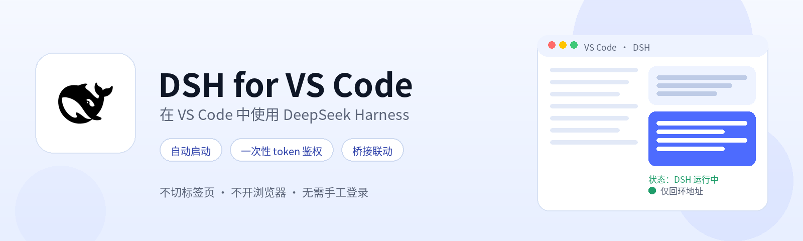
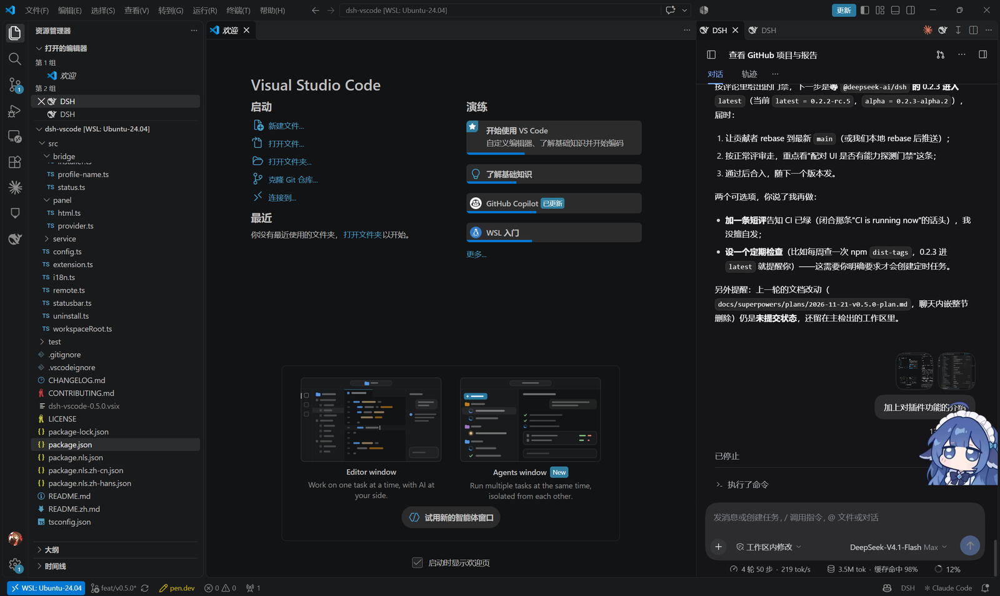
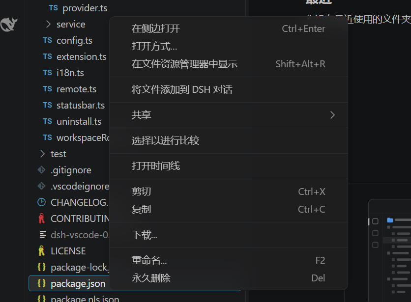
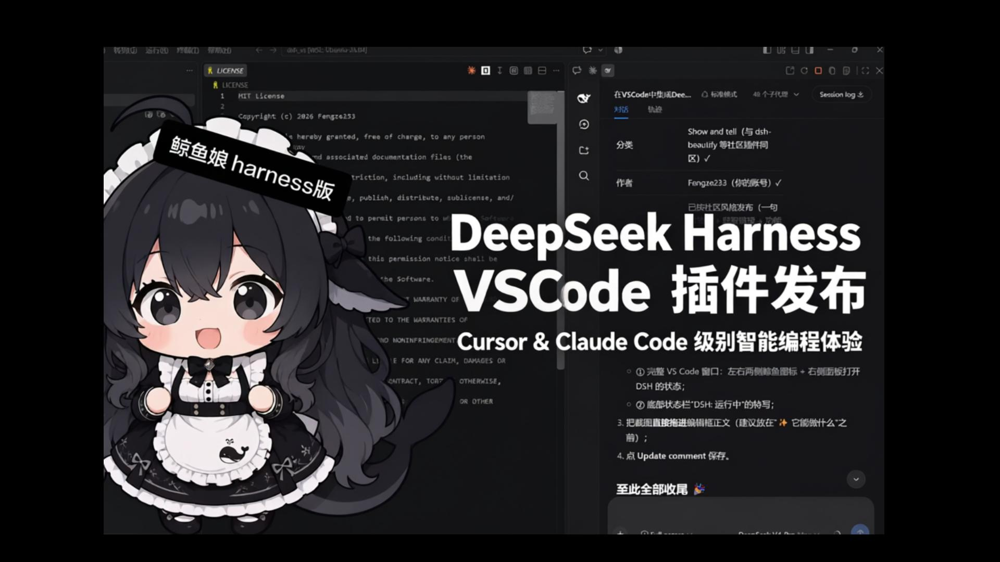
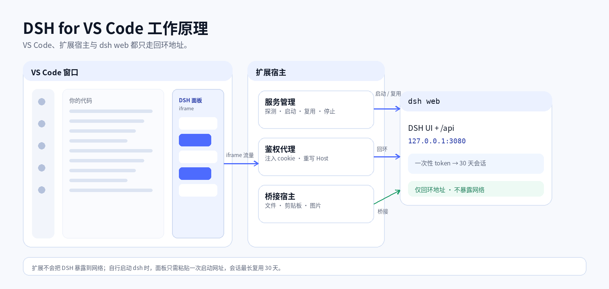

# DSH for VS Code 🐳

[](https://marketplace.visualstudio.com/items?itemName=Fengze233.dsh-vscode-panel)
[](https://github.com/Fengze233/dsh-vscode/releases)
[](https://github.com/Fengze233/dsh-vscode/actions/workflows/ci.yml)
[](https://opensource.org/licenses/MIT)
[](https://code.visualstudio.com/)

[English](README.md) | **中文**



**把完整的 DeepSeek Harness Agent 停在你的代码旁边。**

一次点击，DSH 以编辑区标签页或侧边栏打开。插件负责启动/复用 `dsh web`、完成登录，并把页面接进 VS Code：文件路径可点开、复制按钮可用、图片不丢，右键即可把文件或文件夹加进对话。

[**从 Marketplace 安装**](https://marketplace.visualstudio.com/items?itemName=Fengze233.dsh-vscode-panel) · [下载 VSIX](https://github.com/Fengze233/dsh-vscode/releases) · [3 分钟上手](#-3-分钟上手) · [常见问题](#-常见问题)

```bash
code --install-extension Fengze233.dsh-vscode-panel
```



*两个独立的 DSH 标签页停在代码旁边——每个标签页是自己的一场对话，重载窗口后会自动恢复。*

> **开始之前**：VS Code ≥ 1.91，且 `dsh` 命令可用（npm CLI 或 DSH Desktop）。支持 DSH 0.1.2 及以上；更早的无鉴权版本仍可使用。[安装 DeepSeek Harness →](https://github.com/deepseek-ai/deepseek-harness)

## ⚡ 3 分钟上手

### 1. 安装 DSH（只需一次）

DSH 是 Agent 本体，这个插件是套在它外面的 VS Code 外壳。

- **DSH Desktop（Windows）**：安装桌面端（见 [DeepSeek Harness 仓库](https://github.com/deepseek-ai/deepseek-harness)）。
- **npm**：`npm i -g @deepseek-ai/dsh`

确认命令可用：

```bash
dsh --version
```

如果还没配置模型，先在 DSH 里配置一次——面板打开的就是 DSH 自己的引导页。

### 2. 安装插件

从 [Marketplace](https://marketplace.visualstudio.com/items?itemName=Fengze233.dsh-vscode-panel) 安装，或执行上面的命令，然后重载 VS Code 窗口。

<details>
<summary><b>从 VSIX 或源码安装</b></summary>

**VSIX**：从 [Releases](https://github.com/Fengze233/dsh-vscode/releases) 下载 `dsh-vscode.vsix`，运行 **Extensions: Install from VSIX…**，然后重载窗口。

**源码**：

```bash
git clone https://github.com/Fengze233/dsh-vscode.git
cd dsh-vscode
npm install
npm run package        # 产出 dsh-vscode.vsix
```

</details>

### 3. 打开 DSH

三个入口，同一个 Agent：

| 位置 | 打开方式 |
|---|---|
| **活动栏**的鲸鱼图标 | 左侧边栏里的 DSH |
| **辅助侧边栏**的鲸鱼图标 | 右侧边栏里的 DSH |
| **编辑器标题栏**的鲸鱼图标，或底部状态栏的 `DSH` | **新的 DSH 编辑区标签页** |

再次点击标题栏/状态栏入口，就会再开一个标签页。每个标签页是独立的 DSH 对话；重载窗口后全部自动恢复。

### 4. 把代码加进第一次提问

1. 在资源管理器里右键文件或文件夹 → **将文件添加到 DSH 对话**（文件夹会显示 **将文件夹添加到 DSH 对话**）。
2. 路径会以 `@路径` 进入输入框（文件夹是 `@文件夹/`）。输入问题，按 <kbd>Enter</kbd>。
3. 点击 DSH 回答里的文件路径，会直接在编辑器里打开。

也可以在输入框里输入 `@` 搜索文件和文件夹；在资源管理器里多选后右键，支持一次加入多个。

### 5. 日常控制

- **停止 / 重启**：面板标题栏按钮，或 `DSH: 重启服务` / `DSH: 停止服务`。
- **在浏览器打开**：`DSH: 在浏览器中打开`（需要语音输入时用它，见[已知限制](#-已知限制)）。
- **日志**：`DSH: 查看日志` / `DSH: 复制日志`。
- **缩放**：`dsh.panel.zoomLevel`，把内嵌页面缩放到 50%–150%。

> **首次启动**：由插件自己启动的服务会自动登录。如果你在 VS Code 外启动过 `dsh web`，面板会显示一次性的登录页——把该服务日志里的启动网址粘贴进去（例如 `journalctl -u dsh -n 100`），一次登录最长可用 30 天。

## ✨ 这个插件给你什么

在 DSH Web UI 之外，插件额外提供：

| 功能 | 具体价值 |
|---|---|
| 🗂️ **真正的编辑区标签页，可多开** | 每点一次就新开一个标签页，各自保留一场对话；切走会话不丢，重载窗口全部恢复。 |
| 🔐 **不用手动登录** | 插件捕获 DSH 的一次性启动网址，兑换成 30 天会话，再通过本地回环代理转发面板；插件自启的服务全程无需手动登录。 |
| 📎 **一次右键带入代码上下文** | 文件/文件夹以 DSH 原生 `@` 引用进入输入框——文件夹自动补 DSH 需要的尾斜杠，含空白的路径自动加引号。 |
| 🔗 **原生编辑器联动** | 文件路径在 VS Code 打开，外链走系统浏览器，复制按钮走扩展宿主，内嵌输入框里的撤销/重做也恢复可用。 |
| 🖼️ **没有视觉模型也能发图** | 图片缓存到工作区，以文件路径引用随消息发出，模型仍能读取；可用 `dsh.image.fallback` 关闭。 |
| 🌐 **本地、WSL 与远程** | WSL 开箱即用；SSH Remote、Dev Containers、Codespaces 在开启 `dsh.remote.enabled` 后经 VS Code 隧道打开面板。 |
| ⚙️ **适配你的环境** | 自定义 profile、端口、启动来源（npm / Desktop）、可执行文件路径、额外参数、代理环境、启动超时与页面缩放。 |
| 🛟 **失败时给得出下一步** | `dsh` 缺失、端口占用、启动超时、崩溃、断连都有独立页面，并带一键恢复入口。 |



*右键任意文件或文件夹 → 路径以 DSH 的 `@` 引用插入输入框。*

## 🆚 浏览器标签页 vs VS Code 内

| 要做的事 | 浏览器标签页里的 DSH | VS Code 里的 DSH |
|---|---|---|
| 把文件交给 Agent | 复制路径再手打 `@路径` | 右键 → **将文件 / 文件夹添加到 DSH 对话** |
| 打开 Agent 提到的文件 | 自己去资源管理器里找 | 点一下路径 → 在编辑器打开 |
| 代码和对话同时可见 | 自己摆两个窗口 | 编辑区标签页或侧边栏，就贴在代码旁边 |
| 开多个对话 | 开多个浏览器标签页 | 开多个 VS Code 标签页，重载后自动恢复 |
| 本地服务的登录 | 打开启动网址 | 自动完成 |
| 远程开发 | 自己配端口转发 | 开启 `dsh.remote.enabled`，走 VS Code 隧道 |

## 🎬 看效果

[](https://www.bilibili.com/video/BV1p8bD6dE18)

*Bilibili 59 秒演示：[BV1p8bD6dE18](https://www.bilibili.com/video/BV1p8bD6dE18)*

## 🆕 0.5.1 新特性

- **编辑区标签页真正可多开**——点击编辑器标题栏鲸鱼或状态栏 `DSH`，每次都会新开标签页；标签上显示 DSH 图标。
- **启动即显示状态栏**——窗口一打开就出现 `DSH`，不再要求先用过插件。
- **右键文件夹标题正确**——文件夹显示 **将文件夹添加到 DSH 对话**，不再写成“文件”。
- **引用能被 DSH 正确解析**——文件夹插入为 `@文件夹/`，含空白路径为 `@"my dir/file.ts"`，打开与应用都正常。
- **状态栏点击打开编辑区**——不再跳侧边栏，而是在编辑区新开标签页。

## 🕹 命令

<details>
<summary><b>全部命令</b></summary>

| 命令 | 说明 |
|---|---|
| `DSH: 打开面板` | 聚焦左侧面板 |
| `DSH: 在辅助侧边栏打开` | 聚焦右侧面板 |
| `DSH：在编辑区打开` | 新开一个 DSH 编辑区标签页（标题栏/状态栏入口同此命令） |
| `将文件添加到 DSH 对话` | 资源管理器右键：把选中文件以 `@路径` 插入输入框 |
| `将文件夹添加到 DSH 对话` | 资源管理器右键：把选中文件夹以 `@文件夹/` 插入输入框 |
| `DSH: 在浏览器中打开` | 在系统浏览器打开 DSH 页面 |
| `DSH: 重启服务` | 重启插件管理的服务 |
| `DSH: 停止服务` | 停止插件启动的服务 |
| `DSH: 复制网址` | 复制 DSH 页面地址 |
| `DSH: 查看日志` | 打开 DSH 日志输出通道 |
| `DSH: 复制日志` | 复制完整日志（环境信息 + 服务日志），用于问题报告 |
| `DSH: 重试桥接安装` | 重新安装桥接并重启服务 |
| `DSH: 卸载桥接` | 移除桥接包并还原 `cordis.patch.yml` |
| `DSH: 清理图片缓存` | 删除缓存的 `dsh-imgcache-*` 文件 |

</details>

## ❓ 常见问题

<details>
<summary><b>提示“dsh not found” / 面板启动不了</b></summary>

安装 CLI（`npm i -g @deepseek-ai/dsh`）或 DSH Desktop，并确保命令在 PATH 上。`dsh.launchPreference: auto` 会优先 npm、再回退 Desktop；Desktop 装在自定义目录时设置 `dsh.desktopCommandPath`，使用包装脚本时设置 `dsh.executablePath`。运行 `DSH: 复制日志`，重点看 `dsh 可执行文件` / `dsh 启动来源` / `dsh 实际入口` 三行。
</details>

<details>
<summary><b>面板空白 / 401 / 登录页</b></summary>

DSH ≥ 0.1.2 需要浏览器会话。插件启动的服务会自动登录；在 VS Code 外启动的服务，插件读不到它的日志，需要把启动网址粘贴一次到面板里——登录最长 30 天，服务重启也不需要重新粘贴。可查看 `DSH: 查看日志` 里的地址、端口与 401 处理记录。
</details>

<details>
<summary><b>用 npm 版还是 DSH Desktop？</b></summary>

`auto` 优先 npm，没有则用 Desktop；可用 `dsh.launchPreference: npm` / `desktop` 强制。注意 DSH Desktop 默认用 `desktop` profile，而 VS Code 这边默认用 `web`：会话与设置共享在 `~/.dsh`，但插件按 profile 安装，想在 VS Code 里用 DSH 插件请装进 `web` profile。
</details>

<details>
<summary><b>代理环境下模型 API 连不上</b></summary>

设置 `dsh.useEnvProxy: true`，或用 `dsh.env` 注入 `NODE_OPTIONS=--use-env-proxy` 并提供 `HTTPS_PROXY` / `HTTP_PROXY`。这些变量必须能被 `dsh web` 子进程读到。
</details>

<details>
<summary><b>图片发不出去</b></summary>

确认 `dsh.image.fallback` 为开（默认），且当前打开了工作区文件夹（图片需要缓存到工作区）。支持视觉的模型仍走原生图片上传；`DSH: 清理图片缓存` 可清理残留。
</details>

<details>
<summary><b>SSH Remote / WSL / Dev Containers</b></summary>

开启 `dsh.remote.enabled`，并按 VS Code 提示把插件装到远端。面板会经 VS Code 隧道打开，`dsh` 仍在远端回环地址上监听；WSL 不需要隧道。
</details>

<details>
<summary><b>怎么确认桥接版本？</b></summary>

在 DSH 面板里打开 DevTools，控制台会打印 `[dsh-vscode-bridge] handshake ok, v…`。桥接版本始终与插件版本一致；版本号**或** `client.js` 内容不一致都会强制重装。如果仍是旧版本，运行 `DSH: 重试桥接安装` 或重启 DSH 服务。
</details>

## ⚙️ 设置

<details>
<summary><b>全部 <code>dsh.*</code> 设置</b></summary>

| 设置 | 默认值 | 说明 |
|---|---|---|
| `dsh.profile` | `web` | 启动与安装桥接使用的 DSH profile（自定义 profile 需提供网页界面） |
| `dsh.launchPreference` | `auto` | 优先哪种 `dsh` 安装：`auto`（npm，再 Desktop）、`npm`、`desktop` |
| `dsh.desktopCommandPath` | 空 | Desktop 命令的绝对路径；空则自动探测（也会查 PATH） |
| `dsh.host` | `127.0.0.1` | 服务地址（仅回环） |
| `dsh.port` | `3080` | 期望端口（探测与启动共用） |
| `dsh.autoStart` | `true` | 服务未运行时自动启动 |
| `dsh.stopOnExit` | `true` | 关闭最后一个窗口时停止插件启动的服务 |
| `dsh.extraArgs` | `[]` | 追加给 `dsh web` 的额外参数 |
| `dsh.executablePath` | 空 | `dsh` 可执行文件绝对路径（Windows 为 `dsh.cmd`） |
| `dsh.openInBrowser` | `false` | 启动后在默认浏览器打开 DSH 页面 |
| `dsh.remote.enabled` | `false` | 启用远程场景（经 VS Code 隧道打开面板）；修改后需重载 |
| `dsh.image.fallback` | `true` | 模型无视觉时把图片以文件路径引用发送 |
| `dsh.startTimeoutMs` | `45000` | 等待 `dsh web` 就绪的总超时（Windows 冷启动实测 17–23 s） |
| `dsh.env` | `{}` | 注入 DSH 子进程的额外环境变量 |
| `dsh.useEnvProxy` | `false` | 给子进程的 `NODE_OPTIONS` 追加 `--use-env-proxy` |
| `dsh.panel.zoomLevel` | `1` | 内嵌页面缩放，0.5–1.5 |
| `dsh.workspaceRootIndex` | `0` | 多根工作区：用第几个根作为 `dsh web` 的工作目录 |
| `dsh.workspace.autoOpen` | `true` | 新开的 DSH 标签页自动切到当前 VS Code 工作区并在其中打开（复用）空白会话；重载恢复的标签页不受影响 |
| `dsh.bridge.enabled` | `true` | 启用编辑器桥接（文件链接、剪贴板、撤销/重做、图片） |
| `dsh.bridge.silenceWarning` | `false` | 抑制桥接降级警告 |

</details>

## 🏗 工作原理



插件负责服务生命周期与一个本地回环代理。面板是 VS Code webview 里的 iframe，扩展宿主经 `127.0.0.1` 与 `dsh web` 通信；DSH 页面里的小桥接通过 `postMessage` 转发编辑器动作。

<details>
<summary><b>鉴权与本地回环代理</b></summary>

DSH 0.1.2 引入了强制浏览器鉴权。启动时 `dsh web` 会打印一次性启动网址：

```
dsh web: http://127.0.0.1:3080/?token=<one-time token>
```

访问它会下发 30 天、绑定请求 `Host` 的 `HttpOnly; SameSite=Strict` 会话 cookie。面板是跨站 iframe（顶层是 `vscode-webview://…`），浏览器不会在这种上下文发送该 cookie，所以 iframe 无法自己完成登录。

对插件启动的服务：插件从子进程输出解析启动网址，兑换一次 cookie，按 `host:port` 存入扩展私有存储，然后运行**回环代理**——iframe 加载代理，代理转发到 `dsh web`、注入 cookie、改写 `Host`，并作为受信任的本地中间层去掉浏览器来源头，同时流式转发上传、SSE 与 WebSocket 升级。会话过期时，代理上报上游 `401`，插件自动重新兑换（或重新显示登录页）。

代理只监听 `127.0.0.1`，不暴露到网络。它持有 30 天会话，因此本机进程若发现随机代理端口，可以驱动该会话——本地暴露面与 DSH ≤ 0.1.1 在 `127.0.0.1:3080` 上无鉴权时相同，但不构成网络暴露。

</details>

<details>
<summary><b>编辑器桥接</b></summary>

插件把 `dsh-vscode-bridge` 安装到 DSH 官方客户端插件扩展点（`$DSH_HOME/profiles/<profile>`），并在 `cordis.patch.yml` 里用带标记的 `insert:` 块注册。它带来：

- 外链走系统浏览器，不再被困在 iframe 里；
- 文件路径在 VS Code 打开；
- 复制按钮经扩展宿主转发（VS Code 会拦截跨源 iframe 的剪贴板访问）；
- 内嵌输入框恢复撤销/重做（VS Code 会吞掉快捷键，而编辑器原生撤销栈为空）；
- 当前模型没有视觉能力时，图片仍能送到。

桥接只在面板里生效。若它未激活（浏览器打开、安装失败），面板仍完全可用，只是上述联动缺失；启动时会弹一次降级警告，提供 **重试安装** / **不再提示**。卸载插件或运行 `DSH: 卸载桥接` 会移除桥接包与 `cordis.patch.yml` 里的标记条目。

</details>

## 🌍 多语言

界面文案跟随 VS Code 显示语言：`zh-*` 显示简体中文，其余显示英文。包内包含 `package.nls.json`、`package.nls.zh-cn.json` 与 `package.nls.zh-hans.json`。

## 🧑‍💻 开发

需要 Node.js ≥ 22、VS Code ≥ 1.91。

```bash
npm install
npm run test          # 357 个单元/集成测试（含真实 dsh web 全流程：服务生命周期、鉴权会话）
npm run compile       # 构建 out/extension.js
npm run watch         # 监听构建
npm run typecheck     # 类型检查
npm run package       # 打包 .vsix
```

用 VS Code 打开本目录，按 <kbd>F5</kbd> 启动 Extension Development Host。主要模块在 `src/`：`service/`（探测、进程、启动裁决、状态机）、`bridge/`（安装、握手、消息处理）、`panel/`（HTML 模板与 webview provider），以及 `config.ts`、`workspaceRoot.ts`、`statusbar.ts`。

## 🤝 参与贡献

欢迎提交 Issue 与 PR。PR 尽量小而聚焦，提交前请读 [CONTRIBUTING.md](CONTRIBUTING.md)，并运行 `npm run typecheck`、`npm test`、`npm run compile`、`npx vsce package --no-dependencies`，CI 必须通过。不要改版本号、不要给 CHANGELOG 加版本标题、不要提交 `out/`、`*.vsix` 或本地缓存；`README.md` 与 `README.zh.md` 要同步，测试数必须与 `npm test` 一致。

## 🧭 已知限制

- **从资源管理器 Shift+拖拽（VS Code 上游问题）**：自 1.140 起，资源管理器拖拽不再向 webview 投递 `dragenter`/`dragover`/`drop`（[microsoft/vscode#339278](https://github.com/microsoft/vscode/issues/339278)）。请从系统文件管理器拖入，或在输入框里输入 `@`。跟踪于 [issue #37](https://github.com/Fengze233/dsh-vscode/issues/37)。
- **面板内无法使用麦克风**：VS Code 的 webview iframe 没有委托 `microphone`，DSH 的语音输入在面板里不可用；需要语音时用 `DSH: 在浏览器中打开`。
- **图片降级需要工作区文件夹**：图片缓存在工作区根下；没有打开文件夹时该能力不可用。
- **外部启动的 DSH（≥ 0.1.2）**：插件读不到别的进程的日志，首次登录需要粘贴一次启动网址（之后最长 30 天）。

## 🌐 社区

这是 DeepSeek Harness 社区插件（topic：[`dsh-plugin`](https://github.com/topics/dsh-plugin)）。

- DSH 官方仓库：<https://github.com/deepseek-ai/deepseek-harness>
- Issue 跟踪：<https://github.com/Fengze233/dsh-vscode/issues>
- DSH 社区讨论：<https://github.com/deepseek-ai/deepseek-harness/discussions>

## 🙏 贡献者与致谢

<details>
<summary><b>社区贡献</b></summary>

本扩展的许多改进来自社区（编号对应该 issue/PR）：

**代码贡献**

| 贡献者 | 贡献内容 | 关联 |
|---|---|---|
| [@jubeater](https://github.com/jubeater) | 可配置 DSH profile 与多 profile 桥接清理；停止状态文案与状态栏修复 | #35、#40 |
| [@log-li](https://github.com/log-li) | 图片链接打不开的根因分析与补丁（先判存在、再按文件名兜底） | #45 |

**问题报告**

| 报告者 | 报告内容 | 关联 |
|---|---|---|
| [@Donarli](https://github.com/Donarli) | DSH Desktop 装在非默认盘符（`H:\`）时报 ENOENT，附完整根因分析与修复建议 | #41 |
| [@log-li](https://github.com/log-li) | 聊天里的图片链接必然打不开：定位到 DSH 不写 `title`、桥接退回按钮文案，附生产包实测证据 | #43 |
| [@Joshuayang228](https://github.com/Joshuayang228) | Shift+拖动文件无法进入 webview：定位到 VS Code 回归与 Lexical 第二层原因 | #37 |
| [@AAAwoshi](https://github.com/AAAwoshi) | 切换活动编辑器导致面板整页重载：定位到 `refreshContextBar()` 里多余的 `render()` 与每次渲染重生成 nonce，并附日志采样证据、最小补丁与补丁后复测数据 | #27 |
| [@Joshuayang228](https://github.com/Joshuayang228) | 点文件不转发到编辑器：定位到 CSS Module 哈希类名根因，并附完整实测证据与修法 | #22 |
| [@lizhuoyuan41-droid](https://github.com/lizhuoyuan41-droid) | 桥接包被写进 DSH Desktop 私有命令目录导致桌面启动失败：给出根因与白名单建议 | #20 |
| [@Minelenbolan](https://github.com/Minelenbolan) | `cordis.patch.yml` 桥接条目重复导致插件树崩溃 | #19 |
| [@HafenYin](https://github.com/HafenYin) | Windows 冷启动超过 15 秒被误报超时（附完整启动日志） | #23 |
| [@NOIPJohnny](https://github.com/NOIPJohnny) | 代理环境下 DSH 无法请求模型，建议注入子进程环境变量 | #18 |
| [@ThinBuffalo](https://github.com/ThinBuffalo) | 面板内网页缩放需求 | #8 |
| [@smallshieh](https://github.com/smallshieh) | 编辑器上下文注入需求（当前文件/选区随消息发送） | #10 |
| [@Tsechiyuan](https://github.com/Tsechiyuan) | 选中代码直接发送到会话的需求 | #7 |
| [@sseryling](https://github.com/sseryling) | WSL Remote 下面板白屏与桥接握手失败：附实测修复方案 | #13 |
| [@Zanford](https://github.com/Zanford) | VS Code 中 DSH 无法正常拉起 | #12 |

</details>

<details>
<summary><b>上游问题</b></summary>

- 窄视口下 CJK 输入光标问题（#9）定位到 DSH 前端 composer；上游已改用 Lexical 编辑器。
- 资源管理器 Shift+拖拽是 VS Code 回归（[#339278](https://github.com/microsoft/vscode/issues/339278) / [#339036](https://github.com/microsoft/vscode/issues/339036)），上游修复跟踪于 [microsoft/vscode#344153](https://github.com/microsoft/vscode/pull/344153)。

</details>

## 📄 License

[MIT](./LICENSE) © 2026 Fengze233

---

**现在就可以试：** 从 [Marketplace](https://marketplace.visualstudio.com/items?itemName=Fengze233.dsh-vscode-panel) 安装，或下载 [VSIX](https://github.com/Fengze233/dsh-vscode/releases)。如果 DSH 成为你日常的一部分，Marketplace 上的评分能让更多开发者发现这个插件；GitHub Star 则能帮项目被更多贡献者看到。
